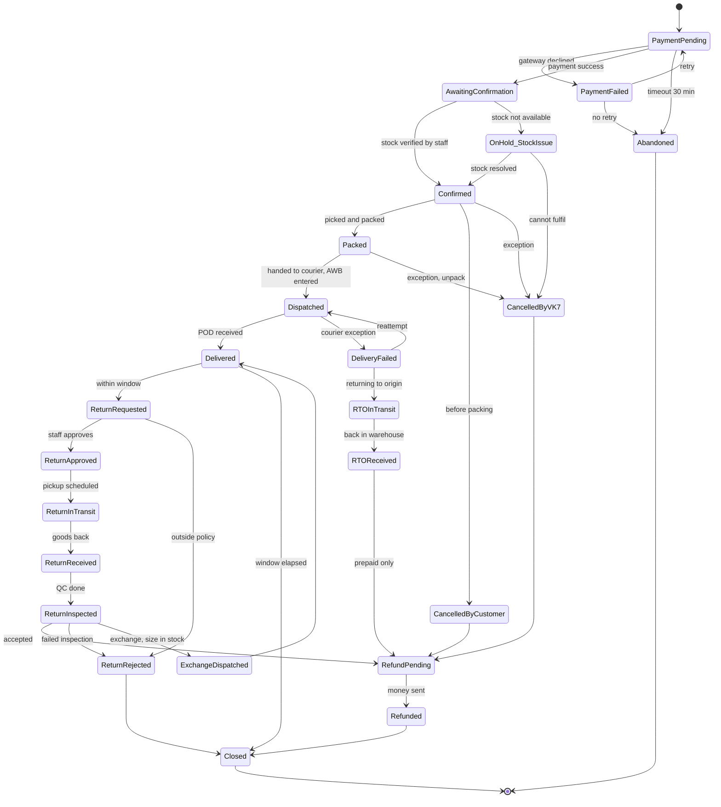
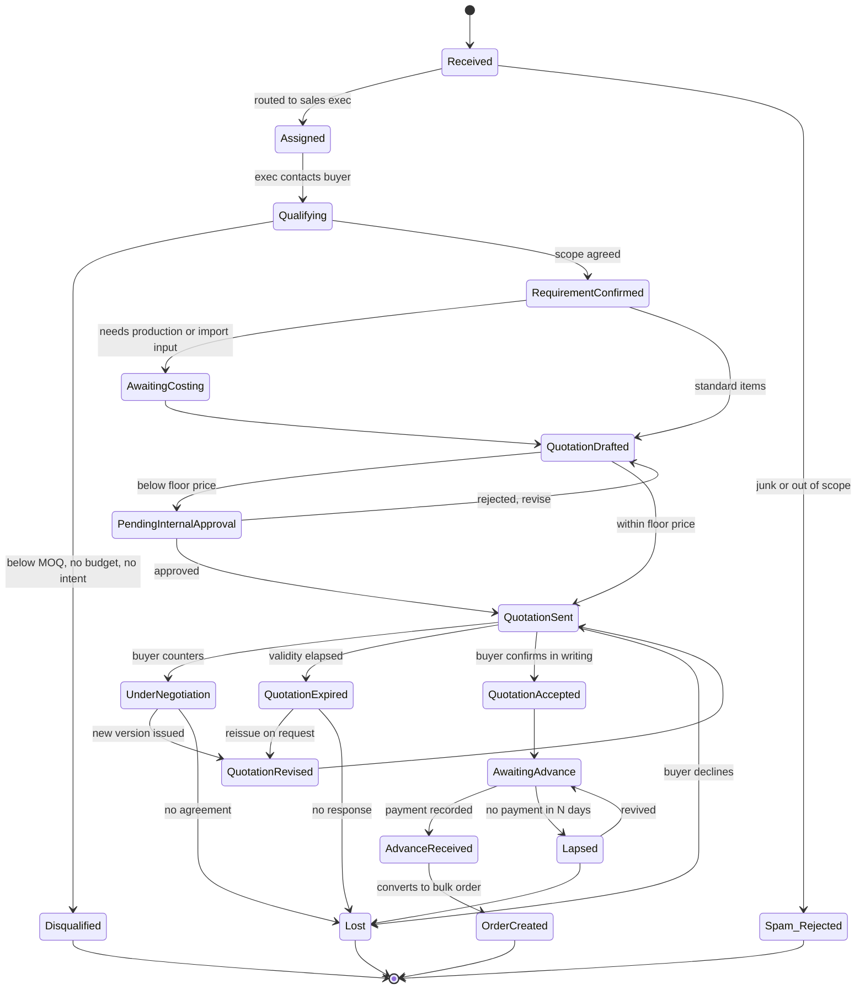
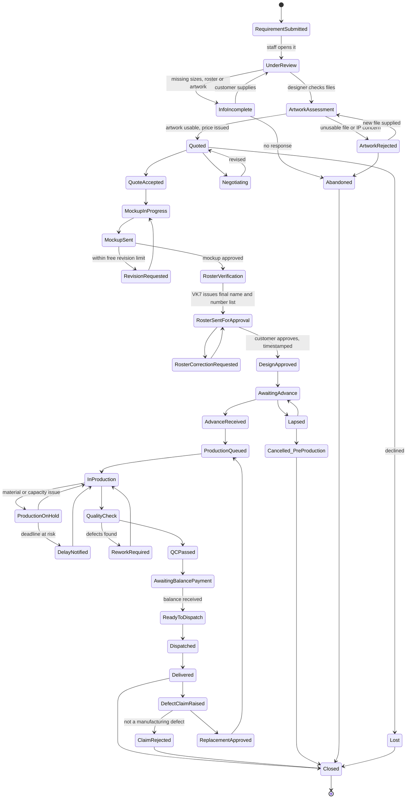
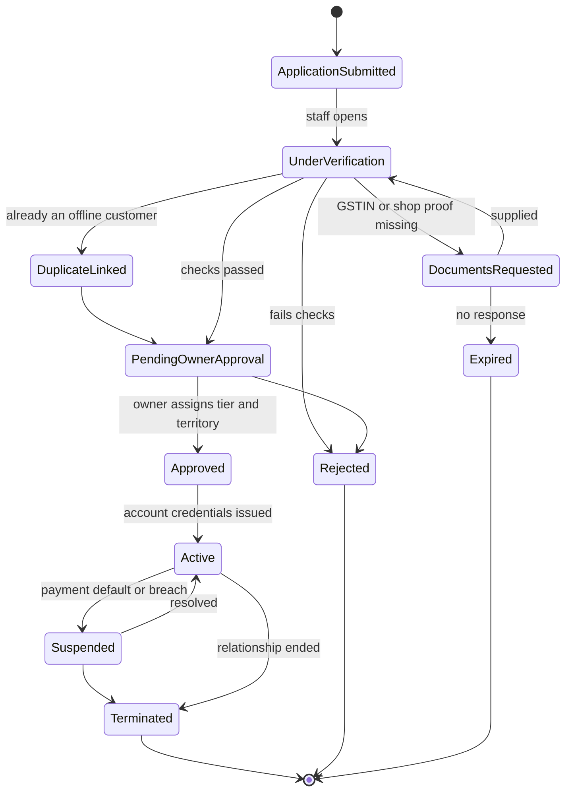
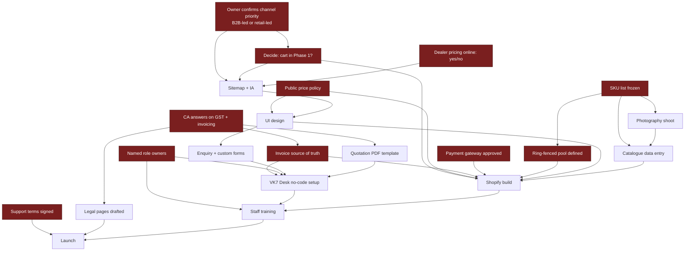
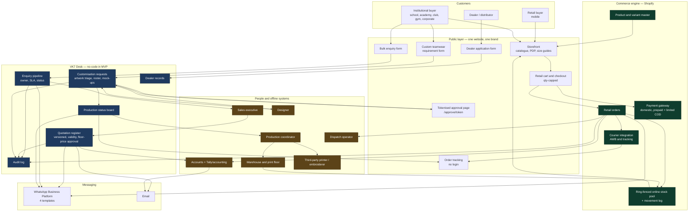
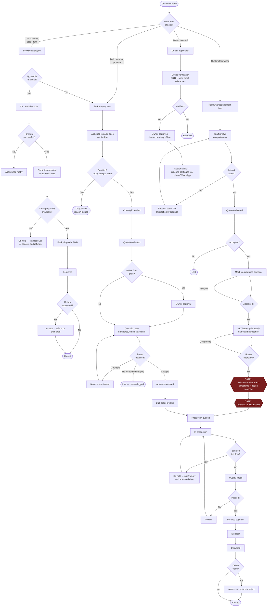

# VK7SPORTS — Critical Audit of the Proposed Website Strategy

**Prepared for:** Avyan (project lead, internal build team)
**Date:** 28 July 2026
**Status:** Pre-design audit. Nothing in this document is a build instruction until the frozen-decision list in Part H is signed off.
**Reference site the owner likes:** wildshark-b2b.com — treated as a *taste signal only*, not a functional brief.

---

## 0. How to read this document

Every material statement is tagged. If it is not tagged, it is narrative connective tissue and carries no weight.

| Tag | Meaning |
|---|---|
| **[FACT]** | Given to us in the brief or verbally by the owner. Still unaudited, but it is what we were told. |
| **[ASSUMPTION]** | Something the current plan silently depends on. Not verified. |
| **[REC]** | My recommendation. Arguable. |
| **[UNRESOLVED]** | A decision nobody has made yet. Blocks work downstream. |
| **[CA/LEGAL]** | Must be answered by a chartered accountant or lawyer. I am not one and will not guess. |

**What we actually know [FACT]:** VK7SPORTS is a premium sportswear business; it sources or imports from China, Taiwan and India; it does roughly ₹1 crore per month through offline, relationship-led, WhatsApp-led and manual processes; it sells both single pieces and bulk; it wants a website first and a mobile app later.

**What we do not know:** the SKU count, the inventory system (if any), pricing tiers, margins, real customer mix, dealer structure and terms, order volumes, the current customisation process, payment terms, warehouse operations, staff responsibilities, returns policy, shipping arrangements, accounting software, and export readiness.

That list is longer than the list of things we know. **Every architectural and feature decision in the current plan is therefore being made on an evidence base of one paragraph.** That is the single most important finding in this audit and it colours everything below.

**Constraint acknowledged:** we will not have that evidence before the demo, because the demo is the instrument for earning access to it. That is a legitimate commercial sequence — but it creates a specific, nameable danger, addressed in §18.1.

---

# PART A — PROBLEM, ASSUMPTIONS, CONTRADICTIONS

## 1. Restating the actual business problem

The plan as written implies the problem is *"VK7SPORTS does not have a website."* That is a description of a missing artefact, not a problem. A business doing ₹1 crore a month without a website does not have a website problem.

Here is the problem restated precisely, in four parts. **[REC]** — these should be confirmed or corrected by the owner before anything is designed.

**P1 — Demand is capped by human bandwidth, not by market size.**
Every order today passes through a person on WhatsApp. That person is the throughput ceiling. Revenue scales only by hiring more of that person, which scales cost linearly and scales error rate faster than linearly. The website's job is to *remove low-value human touches*, not to "sell online."

**P2 — The business has no structured record of its own commerce.**
Prices, quotations, sizes, roster lists, artwork approvals and delivery promises live in chat threads, phone calls and individual memory. This makes the business hard to audit, hard to delegate, hard to value, and hard to defend in a dispute. The website's second job is to become the *system of record*.

**P3 — The business is invisible to buyers who do not already know someone.**
Relationship-led sales cannot reach an academy in a city where VK7 knows nobody. The website's third job is credibility and discoverability for cold institutional buyers — which is a *content and trust* problem far more than a *checkout* problem.

**P4 — Custom teamwear is the highest-margin, highest-error, least-documented workflow.**
Logos, names, numbers, sponsor marks, colour matching, mixed size runs, deadlines. Every one of these is a dispute waiting to happen and today there is no written approval trail. The website's fourth job is to create an *evidence trail for customisation approval*.

**The reframing that matters most [REC]:** For VK7SPORTS, retail B2C checkout is the *least* valuable of the three channels and the *most* expensive to operate correctly. Bulk and custom teamwear are where the revenue and the pain actually are. The current MVP allocates most of its complexity to the least valuable channel. This is backwards and §36 corrects it.

---

## 2–3. Assumption register with classification

Every assumption I could find in the proposed plan. Classification key: **SAFE** / **OWNER** (owner must confirm) / **EMPLOYEE** (staff must confirm) / **CUSTOMER** (must be validated with real buyers) / **CA-LEGAL** / **TECH-RISK**.

### A. Commercial and demand assumptions

| # | Assumption | Class | Why it matters |
|---|---|---|---|
| A1 | Offline ₹1cr/month demand will partially transfer to a website | **CUSTOMER** | Relationship buyers may simply keep using WhatsApp. Transfer is not automatic. This is the project's central unproven bet. |
| A2 | Retail B2C customers exist in meaningful volume for a premium brand with no consumer awareness | **CUSTOMER** | ₹1cr may be almost entirely institutional. If so, the entire retail cart/checkout/COD/returns stack is built for a channel that does not exist yet. |
| A3 | Institutional buyers (schools, academies) will submit enquiries through a web form rather than call | **CUSTOMER** | Indian institutional procurement is phone- and relationship-first. A form may get zero submissions. |
| A4 | Dealers want a self-service portal | **CUSTOMER** | Dealers often prefer a human they can negotiate with. A portal that removes negotiation can *reduce* dealer order volume. |
| A5 | A website will reduce staff workload | **OWNER + EMPLOYEE** | See §18. In the first 6 months a website almost always *increases* workload. |
| A6 | International buyers are a later phase | **SAFE** | Correctly deferred. Keep it deferred. |
| A7 | The owner will accept a scope this narrow after seeing a polished demo | **OWNER** | Demos create appetite. This is a real risk to the project, not a formality. |

### B. Catalogue, pricing and inventory assumptions

| # | Assumption | Class | Why it matters |
|---|---|---|---|
| B1 | A stable, photographable, describable product catalogue exists | **OWNER + EMPLOYEE** | Importers frequently sell whatever container arrived. If the catalogue churns, the site is permanently stale. |
| B2 | Products have consistent SKUs with defined variants | **EMPLOYEE** | If SKUs don't exist today, creating them is a multi-week data project that nobody has budgeted. |
| B3 | Stock quantities are known and reasonably accurate | **EMPLOYEE** | If stock lives in a person's head or a rough ledger, online stock display is fiction. This is the #1 operational failure mode. |
| B4 | There is one retail price per SKU | **OWNER** | Relationship businesses routinely price by who is asking. A public price is a *policy decision*, not a data-entry task. |
| B5 | Wholesale/dealer pricing can be expressed as rules (tiers, % off) | **OWNER** | If dealer pricing is negotiated per dealer per deal, no pricing engine can encode it and dealer self-service is impossible. |
| B6 | Sizes are standardised across suppliers from three countries | **EMPLOYEE + CUSTOMER** | Chinese, Taiwanese and Indian sizing differ. Size confusion is the top driver of apparel returns. |
| B7 | Photography exists or can be produced at premium quality | **OWNER** | A "premium" positioning dies instantly on supplier catalogue photos. This is a budget line, not an afterthought. |

### C. Operational and fulfilment assumptions

| # | Assumption | Class | Why it matters |
|---|---|---|---|
| C1 | Someone will check the website's orders and enquiries every working day | **OWNER + EMPLOYEE** | An unattended enquiry inbox is worse than no website. |
| C2 | Packing, labelling and courier handover can absorb single-piece retail orders | **EMPLOYEE** | A warehouse tuned for 200-piece bulk cartons is not tuned for one jersey to one pin code. |
| C3 | COD is operationally survivable | **OWNER** | COD on custom goods is close to indefensible. COD RTO on stock goods is a real cost. |
| C4 | Returns can be received, inspected, restocked and refunded | **EMPLOYEE** | Most offline-first businesses have no returns process at all. |
| C5 | Production lead times are predictable enough to promise dates | **OWNER + EMPLOYEE** | If lead times depend on import shipments, promised dates become disputes. |
| C6 | Design approval can be captured before production starts, every time | **EMPLOYEE** | Today, production probably starts on a verbal "haan theek hai". |

### D. Technical assumptions

| # | Assumption | Class | Why it matters |
|---|---|---|---|
| D1 | One unified platform can serve retail + bulk + dealer | **TECH-RISK** | See §34. My verdict is no, not in MVP. |
| D2 | A domestic payment gateway will approve VK7SPORTS quickly | **TECH-RISK + OWNER** | Underwriting needs KYC, business proof, sometimes a live site. Can take weeks. Schedule risk. |
| D3 | Shipping integration will work for both a 300g jersey and a 40kg carton | **TECH-RISK** | Aggregator rate cards, weight slabs and surface vs air differ. Bulk usually goes by transporter, not courier — a different system entirely. |
| D4 | WhatsApp notifications can be sent programmatically | **TECH-RISK** | Requires WhatsApp Business Platform, a business-verified number, approved message templates, and per-message cost. Not free, not instant to set up. |
| D5 | Staff will adopt an admin panel | **EMPLOYEE** | Staff adoption failure is the most common cause of e-commerce project death in relationship businesses. |
| D6 | Our team can maintain the platform post-handover | **TECH-RISK** | See §38-R5. This is a governance risk, not a coding one. |

### E. Compliance assumptions

| # | Assumption | Class |
|---|---|---|
| E1 | GST treatment of customised/printed apparel is the same as plain apparel | **CA-LEGAL** |
| E2 | Advance payments on bulk orders have a clean GST/invoicing treatment | **CA-LEGAL** |
| E3 | Website invoices can be issued from the same GSTIN and series as offline | **CA-LEGAL** |
| E4 | Dealer pricing displayed online creates no competition-law or contractual exposure | **CA-LEGAL** |
| E5 | Uploaded club/sponsor logos can be lawfully reproduced by VK7SPORTS | **CA-LEGAL** — this one is underrated and dangerous. See §12. |
| E6 | Collecting player names and jersey numbers for school teams (minors) is unproblematic | **CA-LEGAL** — DPDP Act consent for children's data. Genuinely non-trivial. |

---

## 4. Contradictions between the channels

These are not risks. These are logical conflicts that exist *today* in the plan and must be resolved by a decision, not by engineering.

**C-1 — Retail price vs relationship price.**
Retail checkout requires a public, fixed, self-serve price. A relationship business prices by negotiation. Publishing a price sets a ceiling for every existing customer who has been paying more, and a floor that undercuts nobody. **The first time a loyal offline buyer discovers the website price is lower than his price, you have a channel crisis.** Nothing in the current plan addresses this.

**C-2 — One stock pool, three claims on it.**
Retail cart reserves stock instantly. Bulk enquiry reserves nothing but *expects* availability weeks later. Offline WhatsApp sales consume stock invisibly and in real time. All three draw on the same physical shelf. Without a rule, the website will oversell.

**C-3 — Dealer pricing vs public catalogue.**
Dealers get lower prices. If dealer pricing is visible anywhere online, it leaks to retail buyers and to competing dealers. If it is not visible, dealer "self-service ordering" cannot exist. The plan proposes both.

**C-4 — Custom teamwear is not e-commerce.**
Retail commerce is *transactional and instantaneous*. Custom teamwear is a *project* with a design phase, an approval gate, a production queue and a deadline. Modelling it as an order with a longer status list will fail. It needs its own state machine and its own vocabulary (see §26).

**C-5 — "Order tracking" means three different things.**
For retail: where is my courier. For bulk: has my quotation been approved and has production started. For custom: has my artwork been approved. One tracking screen cannot serve all three without lying to somebody.

**C-6 — WhatsApp both replaced and retained.**
The plan sends notifications *via* WhatsApp while trying to move ordering *off* WhatsApp. Customers will reply to those notifications with order changes. Those replies land in a personal phone, not the system. **The system of record fractures at exactly the moment you declare it the system of record.**

**C-7 — Inventory management contradicts import lead times.**
Showing "in stock / out of stock" implies replenishment predictability. Import-sourced goods from three countries do not replenish predictably. "Out of stock" on a hero product with no restock date is a dead page that still costs SEO and ad spend.

**C-8 — Premium brand vs bulk price-shopper.**
The public storefront must feel premium (owner's taste, per the reference site). Bulk and dealer buyers respond to price, MOQ and lead time. A single homepage cannot be simultaneously aspirational and procurement-efficient. **The reference site the owner likes is a B2B site — worth checking whether he actually wants the premium D2C aesthetic at all, or whether he wants the B2B utility and just liked the polish.** [UNRESOLVED]

---

## 5. Channel-conflict scenarios

Concrete, named scenarios. Each needs an owner decision, not a feature.

| # | Scenario | Consequence if unaddressed |
|---|---|---|
| CC-1 | A dealer's own retail customer buys direct from vk7sports.com at a price below the dealer's resale price | Dealer stops stocking. Worst-case outcome in the whole project. |
| CC-2 | An academy that normally buys through a dealer places a bulk enquiry on the site | VK7 either steals its own dealer's customer or must route the lead back — with no rule for which |
| CC-3 | A long-standing WhatsApp customer sees the website price is lower than his negotiated price | Demands retrospective credit; trust damage |
| CC-4 | Two dealers in the same city discover each other's pricing tier | Tier structure collapses to the lowest tier |
| CC-5 | A retail customer orders 40 pieces through retail checkout at retail price | Warehouse ships 40 pieces at a margin the bulk desk would never have accepted; or you cancel and anger a customer |
| CC-6 | Website shows stock; a WhatsApp order consumed it an hour ago | Oversell, cancellation, refund, review damage |
| CC-7 | A distributor asks why the website undercuts his territory | Territory/exclusivity questions that may not have contractual answers |
| CC-8 | Marketplace sellers (if VK7 sells on any) list at a different price than the site | Price-parity confusion — need to know whether VK7 is on marketplaces at all [UNRESOLVED] |

**[REC] The single decision that defuses CC-1 through CC-5:** publish **one public price** (MRP-anchored, identical for everyone online), keep **all** dealer and bulk pricing off the public internet and behind a human quotation, and cap retail cart quantity per SKU (see §7). Do not attempt online dealer price display in MVP at all.

---

# PART B — EDGE CASES

These are written as failure scenarios because that is how they will arrive.

## 6. Inventory edge cases

| # | Edge case | Handling |
|---|---|---|
| I-1 | WhatsApp sale consumes stock the website has already promised | **[REC] Ring-fence.** See the box below — this is the most important recommendation in the audit. |
| I-2 | Two web customers add the last unit simultaneously | Decrement on payment success, not on add-to-cart. Cart is not a reservation. |
| I-3 | Bulk enquiry "soft-blocks" 500 pieces for 3 weeks while quotation is negotiated | Bulk must **never** touch web stock. Bulk availability is a human answer inside the quotation. |
| I-4 | Physical stock count differs from system count | Requires a stock-take rhythm and a correction log with reason codes. If nobody owns this weekly, the numbers rot within a month. |
| I-5 | Same garment, different supplier country, slightly different shade/fit | These are **different SKUs**, not the same SKU. Merging them creates unresolvable customer complaints. |
| I-6 | Goods in transit from China/Taiwan — sold or not sold? | Needs an explicit "incoming / expected date" concept, or a hard rule of "we never sell what has not landed" [UNRESOLVED — owner decision] |
| I-7 | Damaged / seconds / sample pieces sitting in the same bin | Need a non-sellable status, or they get shipped to a premium customer |
| I-8 | Blank stock consumed by a custom order after printing | Once a blank is printed with a club logo it is no longer generic stock. It must leave the sellable pool at the moment printing is committed, not at dispatch. |
| I-9 | Size-level stock, not product-level | Stock is per SKU-size, always. "Jersey in stock" is meaningless if only 3XL remains. |
| I-10 | Returned item re-entering stock | Must pass inspection first; needs a quarantine state |
| I-11 | Multi-location stock (shop, godown, supplier) | If stock is in more than one place, MVP should track **one location only** — the one the website ships from |

> ### [REC] The Ring-Fenced Online Stock Pool — read this twice
>
> Do not connect the website to "all the stock." Physically segregate a defined quantity of a defined set of SKUs into a marked area — shelves, bins, a corner of the godown — and declare **that** the online stock. The website sells only from that pool. WhatsApp and counter sales are forbidden from touching it without a manual re-allocation.
>
> Cost: near zero. Complexity: near zero. It removes oversell, removes the need for real-time sync with an inventory system that may not exist, removes the need for ERP integration, and caps the blast radius of every inventory error to a small, replenishable pool.
>
> Almost every expensive inventory feature in the proposed plan exists to solve a problem this shelf solves for free.

## 7. Pricing edge cases

| # | Edge case | Handling |
|---|---|---|
| P-1 | Retail buyer orders 40 units at retail price | **[REC]** Hard cap: max N units per SKU per order (owner sets N, suggest 5–10). Above the cap, the cart converts to a bulk enquiry. This is a one-line rule that closes a large margin leak. |
| P-2 | GST-inclusive or GST-exclusive display? | Retail expects inclusive. B2B expects exclusive. Must differ by channel. [CA/LEGAL + OWNER] |
| P-3 | Price break at ₹1,000 (apparel slab) changing effective margin | Rates and slabs must be confirmed with the CA — do not hard-code numbers from memory. [CA/LEGAL] |
| P-4 | Customisation charges: per piece, per colour, per print location, setup fee? | Currently undefined. Until this is a formula, no quotation can be automated. [UNRESOLVED] |
| P-5 | Mixed-size order where 2XL+ costs more to make | Size-based price uplift must be supported at SKU level or explicitly banned |
| P-6 | Import cost changes mid-catalogue-year (FX, duty, freight) | Needs a price-revision process and an effective-date on prices, or quotations issued last month become loss-making |
| P-7 | An old quotation is presented after prices have risen | Every quotation must carry a hard validity date. Non-negotiable. |
| P-8 | Discount codes | **[REC] Reject for MVP.** Discounts on a premium relationship brand with unresolved channel conflict is accelerant on a fire. |
| P-9 | Shipping charged or free above a threshold? | Free-shipping thresholds are a margin decision, not a design decision [OWNER] |
| P-10 | Rounding: ₹1,249.50 | Define rounding policy once, apply everywhere, or invoice totals will not reconcile |

## 8. Quotation edge cases

| # | Edge case | Handling |
|---|---|---|
| Q-1 | Customer negotiates after quotation is issued | Needs quotation **versioning** (v1, v2, v3), never editing in place. Editing in place destroys the audit trail. |
| Q-2 | Two staff quote the same customer differently | Needs enquiry ownership assignment on receipt |
| Q-3 | Quotation expires and customer pays anyway | System must not auto-accept an expired quotation. Requires a human re-issue. |
| Q-4 | Customer accepts quotation but changes quantities | New version, new approval. Not an "edit". |
| Q-5 | Quotation given verbally on phone, never entered | The most likely failure of all. Mitigation is process discipline, not software. |
| Q-6 | Quotation includes items not in the catalogue (custom sourcing) | Quotation line items must allow free-text lines, not only SKU references |
| Q-7 | Partial acceptance — customer wants 3 of 5 line items | Either allowed with a re-quote, or explicitly forbidden [OWNER] |
| Q-8 | Quotation needs to be a PDF the buyer's purchase department can process | Institutional buyers need a formal document with quotation number, validity, tax breakup, T&C. A web page is not enough. |
| Q-9 | Who is allowed to approve a discount below floor price? | Approval threshold rule needed before any pricing screen is designed [OWNER] |
| Q-10 | Customer wants the quotation on their tender format | Manual. Do not attempt to systematise. |

## 9. Payment edge cases

| # | Edge case | Handling |
|---|---|---|
| PY-1 | Payment deducted, order not created (gateway callback lost) | Requires webhook + reconciliation report. Non-optional. |
| PY-2 | Advance paid on custom order, customer cancels after production starts | Needs a written, accepted forfeiture policy shown at the point of advance payment [CA/LEGAL + OWNER] |
| PY-3 | Bulk customer pays by NEFT/RTGS/cheque outside the gateway | The common case for institutions. Needs manual "payment recorded" with a UTR/reference field. |
| PY-4 | Part payments across multiple instalments | Ledger per order, not a single paid/unpaid flag |
| PY-5 | School pays 45 days after delivery on a purchase order | Credit terms. **[REC] Do not build credit-line management. Handle offline in MVP.** |
| PY-6 | COD on a customised jersey with a club logo | **[REC] Forbid COD on customised and bulk. Permanently.** Refused COD on custom goods is unsellable inventory. |
| PY-7 | COD RTO on retail | Real cash cost per attempt. Needs a pin-code allow-list and possibly a partial prepay. |
| PY-8 | Refund on a partially dispatched bulk order | Manual computation. Do not automate. |
| PY-9 | Chargeback / payment dispute | Requires order evidence: approval screenshot, delivery proof, T&C acceptance timestamp |
| PY-10 | Gateway settlement does not match order totals | Daily reconciliation duty must be assigned to a named person |
| PY-11 | Customer pays advance on a quotation that has since expired | Must be blocked, or accepted only by explicit staff action |

## 10. Shipping edge cases

| # | Edge case | Handling |
|---|---|---|
| S-1 | 300g single jersey vs 40kg carton | **Two different logistics systems.** Courier aggregator for retail; transporter/LR for bulk. Do not force bulk through a courier integration. |
| S-2 | Institutional delivery to a school that is closed for vacation | Delivery window field on bulk orders |
| S-3 | Deadline-critical delivery (match day, tournament) | Needs a "required by" date that is *visible to production*, and an honest ability to refuse |
| S-4 | Partial dispatch (200 of 300 ready) | Bulk orders need multi-shipment support; retail does not |
| S-5 | Address unserviceable / wrong pin code | Serviceability check at checkout, not after order |
| S-6 | E-way bill for consignments above the statutory threshold | [CA/LEGAL] — who generates it, from which system |
| S-7 | Freight recovered from customer on bulk | Freight is a quotation line item, not a checkout calculation |
| S-8 | Customer arranges own transport / self-pickup | Must exist as a dispatch mode |
| S-9 | Damage in transit on a custom order | Reproduction takes weeks. Needs a documented claim process. |
| S-10 | Courier marks delivered, customer says not received | Requires POD retrieval process |
| S-11 | International shipping | **Out of scope. Confirmed.** Not "later in MVP". Not at all. |

## 11. Returns and exchange edge cases

| # | Edge case | Handling |
|---|---|---|
| R-1 | Custom-printed item returned | **[REC] Non-returnable, stated at three points: product page, cart, and design-approval screen.** Only manufacturing defects accepted. |
| R-2 | Size exchange — the most common real return | Exchange requires the replacement size to be in stock. If not, it becomes a refund. Design for that branch. |
| R-3 | Bulk order: 12 of 300 pieces defective | Partial return / replacement of a sub-quantity. Retail return logic cannot express this. |
| R-4 | Return window vs bulk production lead time | Different windows per channel [OWNER] |
| R-5 | Worn / washed / used item returned | Needs an inspection step with photographic evidence before refund |
| R-6 | Reverse pickup unavailable in the pin code | Customer self-ships; needs a reimbursement rule |
| R-7 | Refund to a COD order | Requires bank details capture — a support burden and a fraud surface |
| R-8 | Dealer returns unsold stock | **[REC] Not supported. Dealer returns are a commercial negotiation, not a website feature.** |
| R-9 | Returned goods restocking | Quarantine → inspect → restock or write off (see I-10) |

## 12. Customisation and design-approval edge cases

This is the highest-risk workflow in the business and the least specified in the plan.

| # | Edge case | Handling |
|---|---|---|
| X-1 | Customer uploads a 200KB blurry JPEG of a logo | Print requires vector or high-res. Needs an explicit file-requirement gate and a staff "artwork usable / not usable" decision step. Most uploads will fail this. |
| X-2 | Customer uploads a copyrighted club, league or brand logo | **[CA/LEGAL] — serious.** VK7SPORTS manufactures the infringement. Requires an explicit warranty checkbox: *"I confirm I own or am authorised to use this artwork."* Store the timestamp. |
| X-3 | Sponsor logo with brand guidelines VK7 cannot meet | Colour matching disputes. Needs an approval artefact that shows exact colours used. |
| X-4 | Player roster with 24 names, 3 misspelled by the customer | **[REC] Approval must be of the *final printed name list as VK7 will print it*, not of the customer's uploaded file.** Spelling liability transfers on approval. This single design decision prevents the most expensive class of dispute. |
| X-5 | Roster changes after approval, before production | Needs a change-request state with a cut-off point and a re-approval |
| X-6 | Roster changes after production starts | Chargeable. Policy needed. [OWNER] |
| X-7 | Colour on screen vs colour on fabric | Disclaimer + physical sample option for large orders |
| X-8 | Customer approves, then claims they did not | Approval must record: who, when, IP/device, and the exact artefact version approved |
| X-9 | Mixed sizes with names — S:4, M:9, L:8, XL:3 and each name bound to a size | The data model must bind name+number+size as one row per player. A quantity-by-size grid alone is insufficient. |
| X-10 | Minor children's names on school kits | [CA/LEGAL] — DPDP consent for children's personal data. Genuinely unresolved; needs advice. |
| X-11 | 2D mock-up production capacity | Every enquiry that reaches mock-up stage consumes designer hours. If enquiry volume rises 10×, mock-ups become the bottleneck. **Gate mock-ups behind a qualification step or a token fee.** |
| X-12 | Customer wants revisions 6 times | Free revision limit must be stated up front [OWNER] |

## 13. Dealer account and permission edge cases

| # | Edge case | Handling |
|---|---|---|
| D-1 | Fake dealer application to obtain wholesale pricing | Verification is mandatory: GSTIN, shop proof, reference. Never auto-approve. |
| D-2 | Approved dealer shares login with a retail customer | Rate leakage. Mitigate by not showing rates online at all in MVP. |
| D-3 | Dealer relationship ends | Needs suspend/revoke, not delete — history must survive |
| D-4 | Multiple users at one dealer firm | Organisation-level account with users under it. Person-level accounts break when staff leave. |
| D-5 | Dealer applies but already buys offline | Duplicate identity. Needs a merge/link path to the existing offline customer record. |
| D-6 | Two dealers claim the same territory | Territory is a contract question, not a feature [OWNER] |
| D-7 | Dealer's outstanding balance | **[REC] Not in MVP.** Credit ledgers online invite disputes about numbers the accounts team owns. |
| D-8 | Dealer wants to see stock availability | Reveals inventory position to a party who may also be a competitor's dealer. [OWNER decision — my rec is no in MVP.] |
| D-9 | Dealer changes GSTIN / firm name | Needs an amendment path with audit trail |

## 14. Production status edge cases

| # | Edge case | Handling |
|---|---|---|
| PR-1 | Production is at a third-party printer/embroiderer | Status updates depend on a vendor who is not in the system. MVP status must be staff-entered, not integrated. |
| PR-2 | Partial production complete | Needs quantity-level progress, not just a stage flag |
| PR-3 | Production defect discovered at QC — reprint needed | Loops back to production; deadline may now be unmeetable. Needs a "delay notified" state and a customer communication trigger. |
| PR-4 | Blank fabric shortage mid-production | Order goes on hold with a reason. Customer must be told, not left watching a stale status. |
| PR-5 | Customer visible status too granular | **[REC] Customers see 4 stages maximum. Staff see the real detail.** Over-exposing production status creates chasing behaviour and phone calls — the opposite of the goal. |
| PR-6 | Deadline slips | Requires an explicit, logged, customer-acknowledged revised date. Silent slippage is how relationships end. |
| PR-7 | Order marked dispatched but still on the floor | Status changes must be tied to a real physical action with a person's name against it |

---

# PART C — COMPLIANCE, DATA, PEOPLE

## 15. GST, invoicing and accounting questions for the CA

**I will not state a single tax rate, threshold or rule in this document.** Rates and rules change, and a wrong number here becomes a wrong number in the code. Every item below is a question to be put to VK7SPORTS's chartered accountant in writing, with the answer recorded before development begins.

**Classification and rate**
1. What is the correct HSN classification and applicable GST rate for each product family we intend to sell online?
2. Does the applicable rate change with the price of the garment, and if so, at what threshold and on what basis (per piece, per invoice line)?
3. Does printing/embroidery on a garment we own and sell change the classification, the rate, or make it a composite supply? What is the principal supply?
4. If a customer supplies the blank garment and we only print it, is that job work, and does it carry a different rate and different documentation?

**Advances, invoicing and documents**
5. What is the correct treatment of advance payments received on bulk/custom orders — is a tax invoice, receipt voucher, or nothing required at the time of advance?
6. If an order is cancelled after advance, what document reverses it?
7. Can website sales use the same GSTIN and the same invoice series as offline, or do we need a separate series? What is your preference for reconciliation?
8. Who generates the invoice — the website, or Tally/the accounting software? **This is the most important question on the list.** [see §18.2]
9. Is e-invoicing applicable to VK7SPORTS at its current turnover, and if so does that change where invoices must originate?

**Place of supply and logistics**
10. How is place of supply determined for a delivery to a school in another state when the purchase order comes from a head office in a third state?
11. What is the e-way bill obligation for our typical bulk consignment, and who in the team generates it?
12. For dispatches where the customer arranges their own transport, does the obligation shift?

**Returns, credit notes, COD**
13. Correct document flow for a return: credit note timing and its effect on the return filing period.
14. Treatment of a partial return on a bulk invoice.
15. COD collections: when is the supply deemed to occur — dispatch or collection?

**Other**
16. TDS/TCS implications when institutional buyers deduct at source on our invoices.
17. Any implication of listing prices GST-inclusive to consumers and GST-exclusive to businesses on the same domain.
18. Confirm no e-commerce operator obligations arise from operating our own D2C website (as distinct from selling on a marketplace).

**Legal (separate from CA):**
19. Terms of Sale, Return Policy, Privacy Policy and a customer-artwork IP warranty clause — drafted, not copy-pasted from another site.
20. DPDP Act obligations: consent, notice, data of children (player names on school kits), retention period, and grievance officer designation.
21. Dealer agreement: does an approved website dealer account create any contractual right? What terminates it?

## 16. Data that must be migrated from the existing operation

**[ASSUMPTION]** — none of this currently exists in structured form. Each line is a project, not an import.

| Data | Likely current form | Effort | Blocking? |
|---|---|---|---|
| Product master (name, category, description) | Supplier catalogues, photos on a phone | High | **Yes — blocks everything** |
| SKU + variant matrix (colour × size) | In people's heads | High | **Yes** |
| Cost price / landed cost per SKU | Import invoices, possibly a spreadsheet | Medium | Yes, for pricing decisions |
| Selling price(s) | Negotiated, inconsistent | High (it's a decision, not a migration) | **Yes** |
| Current stock by SKU-size | Physical count, ledger, or nothing | High | Yes (mitigated by ring-fencing) |
| Product photography | Supplier images, WhatsApp forwards | **Very high — this is the hidden budget bomb** | **Yes** |
| Customer list (retail) | Phone contacts, chat threads | Low value | No |
| Institutional customer list | Phone contacts, invoices | Medium | No, but high commercial value |
| Dealer list + terms | Owner's memory | Medium | Only if dealer module ships |
| Past quotations | Chat threads, paper | Low | No |
| Artwork library (repeat clients' logos) | Designer's laptop | Medium | No, but valuable |
| Size charts per product family | Probably does not exist | Medium | **Yes — drives returns** |
| HSN codes per product | Accountant's records | Low | Yes, for invoicing |

**[REC]** Photography and the SKU/price master are the two long-poles. Start both *before* development, in parallel with design. If they start when development starts, launch slips by the length of the photography schedule.

## 17. Information the owner probably does not maintain in structured form

Ask these directly. Expect the honest answer to be "not written down anywhere."

- Which products actually make money after landed cost, and which are sold as favours
- Revenue split across retail / bulk / custom / dealer
- Repeat-purchase behaviour of institutional customers
- Dealer terms: margin, MOQ, territory, credit, returns — per dealer
- Production capacity per week for printing and embroidery
- Realistic lead times by order type, measured rather than promised
- Defect and rework rate
- Cancellation and dispute history
- Who is authorised to approve what discount
- Import lead times and reorder points
- Which SKUs are permanent lines vs one-time container buys

**The last item is strategically critical.** If the catalogue is mostly opportunistic container buys, a catalogue-driven website is structurally wrong and the site should be positioned around *capability* (we make teamwear to your spec) rather than *inventory* (buy this jersey).

## 18. Where the website could create MORE work, not less

Being blunt here, because this is how these projects die.

**18.1 — The demo trap (highest priority, specific to your situation).**
You are building a demo to win budget approval before you have operational data. Whatever the demo shows becomes, in the owner's mind, what he is paying for. If the demo shows a slick size-selector, a real-time stock badge, an instant quotation and a jersey preview, you have quietly committed to building four things you do not have the data to support.

**[REC] Design the demo as a deliberately honest artefact.** Show the storefront, the enquiry funnel, the quotation document, and the internal dashboard. Show *manual* steps as manual, with a human's name on them. A demo that visibly says "our team reviews and prices this within 24 hours" is more credible to a businessman than one that pretends to be automatic — and it does not mortgage your build.

**18.2 — Double data entry.** If invoices are raised in Tally and orders live on the website, someone re-types every order. That is new work created by the website. It is survivable at low volume and fatal at high volume. Decide the single source of truth for invoicing **before** development. [UNRESOLVED — blocking]

**18.3 — The enquiry firehose.** A public enquiry form attracts low-quality, low-intent, price-fishing enquiries. Staff will spend hours quoting people who will never buy. Mitigate with qualification fields (organisation name, quantity, required-by date, budget) and an explicit statement of MOQ.

**18.4 — Free mock-ups as a customer-acquisition cost.** See X-11. Every unqualified mock-up is designer hours spent on nothing.

**18.5 — Stock-accuracy maintenance.** Somebody must count and correct. That is a new recurring job.

**18.6 — Two inboxes.** Website enquiries plus WhatsApp. Unless the website enquiry is *routed into the same place staff already look*, it will be checked once a week. **[REC] Every website enquiry should fire a WhatsApp/email alert to a shared number the sales staff already watch.** Meet the staff where they are.

**18.7 — Returns processing.** A process that does not exist today.

**18.8 — Content upkeep.** New arrivals, sold-out products, seasonal pages. Without an owner, the site looks abandoned in 90 days.

**18.9 — Customer support inbound.** "Where is my order", "will it fit", "can you do 200 by Friday". Web traffic generates questions, and questions land on a phone.

## 19. Staff roles required to operate the platform daily

Minimum viable operating team. **[REC]** These can be existing people wearing new hats, but each hat must have a name against it before launch.

| Role | Daily duties | Can be shared? |
|---|---|---|
| **Catalogue owner** | Add/edit products, prices, photos, stock corrections | Yes, part-time |
| **Retail order processor** | Confirm, pack, label, hand to courier, update status | Must be daily |
| **Enquiry/quotation executive** | Respond to bulk enquiries within SLA, build quotations, negotiate | **The critical hire/assignment.** Sales skill, not admin skill |
| **Designer / artwork** | Assess uploaded artwork, produce 2D mock-ups, prepare print files | Existing person, new queue |
| **Production coordinator** | Update production stage, flag delays | Existing person |
| **Accounts** | Payment reconciliation, invoices, refunds, GST | Existing |
| **Dealer/account approver** | Verify and approve dealer applications | Owner or trusted senior — low volume |
| **Admin/superuser** | User management, config, price rules | Owner + one backup |

**[REC] Name the enquiry executive before you write a line of code.** If no one owns the enquiry queue, the bulk channel — the commercially important one — fails silently.

## 20. Workflows that should stay MANUAL in the MVP

| Workflow | Why manual |
|---|---|
| Quotation pricing | The pricing logic is not knowable yet, and margin judgement is the business's edge |
| Bulk stock availability confirmation | Depends on production capacity and incoming shipments, neither of which is in a system |
| Dealer verification and approval | Fraud gate; volume is low |
| Design/artwork usability assessment | Human judgement |
| Production scheduling | Capacity lives with the production head |
| Credit terms and payment plans | Commercial negotiation |
| Bulk freight quoting | Transporter rates are negotiated per consignment |
| Refund approval | Judgement + fraud control |
| Deadline commitment | Never let software promise a date |

## 21. Workflows that MUST be digital from day one

| Workflow | Why non-negotiable |
|---|---|
| Enquiry capture with structured fields | The whole point. Unstructured enquiries = WhatsApp with extra steps |
| Quotation issuance as a numbered, dated, versioned document | Legal and commercial evidence |
| **Design approval capture with timestamp and version** | The single highest-value digital artefact in the entire system |
| Order status as a single shared record | Kills "let me check and call you back" |
| Payment record against order | Reconciliation |
| Product catalogue with prices and images | Table stakes |
| Retail order capture with address and contact | Table stakes |
| Audit log of who changed what | Dispute resolution and staff accountability |

## 22. Workflows that should NEVER be fully automated

1. **Final price on a bulk or custom order.** Margin judgement is the business.
2. **Delivery date commitment on custom production.** Software cannot see the factory floor.
3. **Dealer approval.** A fraud and channel-conflict gate.
4. **Design/artwork sign-off as printable.** A machine cannot judge print quality.
5. **Refund and goodwill decisions.** Relationship judgement.
6. **Acceptance of an urgent, high-value or unusual order.** Someone must be able to say no.
7. **Anything that publishes dealer pricing.**

## 23. Audit of proposed roles and permissions

The plan says "role-based staff access" without saying which roles. That is a gap, because permissions determine screens, and screens determine design.

**[REC] Proposed role model — 6 roles, no more, in MVP:**

| Role | Can | Cannot |
|---|---|---|
| **Owner / Super Admin** | Everything, including price rules, user management, dealer approval, discount override | — |
| **Sales Executive** | View + respond to enquiries, create quotations within floor price, view customer records | Change catalogue prices, approve dealers, issue refunds, discount below floor |
| **Catalogue Manager** | Create/edit products, images, descriptions, stock adjustments | See margins/cost price, see quotations, change published prices without approval |
| **Order/Dispatch Operator** | View confirmed orders, print labels, mark packed/dispatched, enter AWB | See prices or customer payment data |
| **Designer** | View customisation requests, upload mock-ups, mark artwork usable/unusable | See prices, change order status |
| **Accounts** | Record payments, issue refunds, export for GST, view all financials | Change catalogue, change order status |

**Audit findings on permissions:**
- **Cost price must be visible to almost nobody.** It is the most sensitive field in the system and the plan does not mention protecting it.
- **A "floor price" concept must exist** or sales executives will discount to close, and nobody will notice until month-end.
- **Every status change and every price change must be logged with a user ID.** Without this, disputes become word-against-word.
- **Do not create a "Manager" role that means "almost everything".** It becomes the default account everyone shares.
- **No shared logins.** One human, one account. If staff share logins, the audit log is worthless and the whole accountability argument for the platform collapses.
- Dealer users are **customers**, not staff. Keep them in a completely separate identity space.

---

# PART D — STATE MACHINES

Design rule applied throughout: **every state must be enterable by a real human action, exitable, and visible to someone who cares about it.** States that exist only to look complete are removed.

Second rule: **the customer-visible state set is smaller than the internal state set.** Mapping is given per machine.

## 24. Retail order state machine



**Customer sees only:** Payment Pending → Order Confirmed → Packed → Shipped → Delivered → (Return/Refund states if invoked).
**Rules:** stock decrements at `AwaitingConfirmation`, not at cart. Cancellation is permitted by the customer only before `Packed`. Every cancellation requires a reason code.

## 25. Bulk enquiry and quotation state machine



**Every terminal `Lost` requires a loss reason** (price, lead time, went to competitor, no budget, no response). Without this the enquiry funnel teaches you nothing.
**SLA gate:** `Received → Assigned` must have a maximum time. Enquiries that age past it should escalate visibly.

## 26. Custom teamwear order state machine

This is a **project**, not an order. Note the two hard gates — nothing crosses them without a human act.



**Gate 1 — `DesignApproved`.** Nothing enters production without it. It is the legal spine of the workflow.
**Gate 2 — `AdvanceReceived`.** No production on credit for custom goods.
**Change requests after `ProductionQueued`** are a separate chargeable flow, not a state transition. If a roster change arrives after this point, staff cancel and re-issue at the customer's cost, or absorb it as a commercial decision — a human call, logged.
**Customer sees only:** Submitted → Under Review → Quotation Sent → Mock-up Sent → Design Approved → In Production → Ready → Shipped → Delivered.

## 27. Dealer application state machine



**Never auto-approve.** Records are never deleted — `Terminated` preserves order history.

## 28. Cancellation and exception states — consolidated

| Workflow | Cancellation states | Exception states | Who can trigger |
|---|---|---|---|
| Retail order | `CancelledByCustomer` (pre-pack only), `CancelledByVK7`, `Abandoned` | `PaymentFailed`, `OnHold_StockIssue`, `DeliveryFailed`, `RTOInTransit`, `ReturnRejected` | Customer (limited), Order Operator, Accounts |
| Bulk enquiry | `Disqualified`, `Lost`, `Lapsed`, `Spam_Rejected` | `QuotationExpired`, `PendingInternalApproval` | Sales Exec, Owner |
| Custom teamwear | `Abandoned`, `Lost`, `Cancelled_PreProduction`, `ClaimRejected` | `InfoIncomplete`, `ArtworkRejected`, `ProductionOnHold`, `DelayNotified`, `ReworkRequired` | Sales Exec, Designer, Production Coordinator, Owner |
| Dealer application | `Rejected`, `Expired`, `Terminated` | `DocumentsRequested`, `Suspended`, `DuplicateLinked` | Sales Exec (verification), Owner (approval) |

**Universal rules:**
1. Every cancellation carries a **mandatory reason code** and free-text note.
2. **No state is deleted.** Records move to terminal states and stay queryable.
3. Any state a record can enter but not leave without a human is an **exception state** and must appear on a staff worklist. If it does not appear on a worklist, orders die silently in it.
4. **There is no automatic cancellation of anything a customer has paid for.**

---

# PART E — DATA STRUCTURES

Given as logical models. Deliberately conservative: fields that cannot be populated from real VK7SPORTS data on day one are marked `[deferred]` and should not exist in the MVP schema.

## 29. Product and SKU structure

Three levels. Collapsing them is the most common modelling mistake in apparel.

```
PRODUCT (the marketing object — what a customer browses)
  product_id
  name, slug
  category_id, subcategory_id
  product_family          e.g. Football Jersey, Track Pant
  description_short, description_long
  fabric, gsm, fit, care_instructions
  size_chart_id           REQUIRED, family-specific
  is_customisable         bool
  customisation_options[] print | embroidery | name | number | sponsor
  min_order_qty_retail, max_order_qty_retail   drives the P-1 cart cap
  min_order_qty_bulk
  hsn_code
  images[]                ordered, with alt text
  status                  draft | active | archived
  seo_title, seo_description
  [deferred] related_products, care_video

VARIANT (the sellable object — colour × size)
  variant_id
  product_id
  sku_code                human-readable, printed on the bin label
  colour_name, colour_hex
  size_label              S | M | L | XL | 2XL ... family-specific
  size_sort_order         so sizes never sort alphabetically
  mrp
  selling_price_retail
  price_effective_from
  cost_price              RESTRICTED — Owner and Accounts only
  floor_price             minimum a Sales Exec may quote
  weight_grams            for courier rating
  barcode                 optional
  status                  active | discontinued | not_for_online

INVENTORY (see §33 — deliberately a separate object, not a field on VARIANT)
```

**Findings:**
- `size_sort_order` is a one-field fix for a bug that otherwise appears on every product page.
- `floor_price` on the variant is what makes the discount-approval rule enforceable.
- `not_for_online` status is what lets the owner keep dealer-only or clearance lines off the public site.
- Customisation is a **product capability flag plus a separate request object** — never a variant. Modelling "Blue jersey with Sharma printed on it" as a SKU generates infinite SKUs. This is the single most damaging modelling error available and the current plan does not rule it out.

## 30. Customer and organisation structure

**[REC] Two-entity model.** A person is not an account. An institution is.

```
CUSTOMER_ACCOUNT
  account_id
  account_type            retail | organisation | dealer
  display_name
  status                  active | suspended | terminated
  created_via             website | staff_entry | migrated_offline
  linked_offline_ref      free text, to reconcile with existing records
  notes                   internal only

  -- organisation and dealer only --
  legal_name
  organisation_type       school | college | academy | club | gym | corporate | event_organiser | dealer | distributor | retailer
  gstin, pan
  billing_address, default_shipping_address
  [dealer only] dealer_tier, territory, agreement_date
  [dealer only] approval_status, approved_by, approved_on
  [deferred] credit_limit, payment_terms_days

CONTACT_PERSON            many per account
  contact_id, account_id
  name, role, phone, whatsapp, email
  is_primary
  can_place_orders        bool
  can_approve_designs     bool     <-- critical for institutions
  login_enabled

ADDRESS                   many per account
  address_id, account_id, label
  line1, line2, city, state, state_code, pincode, country
  contact_name, contact_phone
  type                    billing | shipping | both
  delivery_window_note    e.g. "closed 15 Apr - 10 Jun"
```

**Findings:**
- `can_approve_designs` matters enormously. A school peon must not be able to approve a ₹3 lakh jersey artwork. The current plan has no concept of approval authority.
- `linked_offline_ref` is what prevents the website from creating a parallel customer universe.
- `delivery_window_note` prevents the closed-school delivery failure (S-2).
- Dealer credit fields are `[deferred]` on purpose. Do not build them.

## 31. Quotation structure

```
QUOTATION
  quotation_id
  quotation_number        sequential, human-readable, never reused
  version                 1, 2, 3 ... immutable once sent
  parent_quotation_id     links versions
  enquiry_id
  account_id, contact_id
  status                  see §25
  issued_by               user_id
  issued_on, valid_until  REQUIRED
  currency                INR only in MVP
  subtotal, discount_total, tax_total, freight, grand_total
  tax_breakup[]           per rate, per line
  payment_terms_text      free text
  advance_percent, advance_amount
  estimated_lead_time_days
  delivery_terms_text
  terms_and_conditions_snapshot   <-- copy, not reference
  internal_margin_note    RESTRICTED
  loss_reason             on Lost
  pdf_url

QUOTATION_LINE
  line_id, quotation_id, line_no
  line_type               catalogue | custom | charge
  variant_id              nullable for custom and charge lines
  description             free text, always populated
  size_breakup[]          {size, qty} pairs
  quantity, unit_price, discount, tax_rate, line_total
  customisation_request_id   nullable
  hsn_code
```

**Findings:**
- **Versions are immutable.** Editing a sent quotation in place is how disputes become unwinnable.
- `terms_and_conditions_snapshot` stores the actual text sent. If T&C change next year, last year's quotation still shows what was agreed.
- `line_type = charge` covers setup fees, artwork charges, freight and rush surcharges without polluting the product catalogue.
- `valid_until` is mandatory at the schema level, not the UI level.

## 32. Customisation request structure

The most under-specified object in the current plan and the one carrying the most legal weight.

```
CUSTOMISATION_REQUEST
  request_id
  account_id, contact_id
  linked_enquiry_id / linked_order_id
  product_id              base garment
  colour_variant_id
  status                  see §26
  required_by_date
  ip_warranty_accepted    bool + timestamp + accepted_by_contact_id   [CA/LEGAL]
  free_revisions_used, free_revisions_allowed
  internal_notes

ARTWORK_ASSET             many per request
  asset_id, request_id
  file_url, original_filename, mime_type, file_size, dimensions
  purpose                 team_logo | sponsor_logo | reference_image | colour_reference
  uploaded_by, uploaded_on
  usability_status        pending | usable | needs_better_file | rejected_ip
  assessed_by, assessment_note

PLACEMENT                 many per request
  placement_id, request_id
  location                chest_left | chest_centre | back | sleeve_left | sleeve_right | collar | shorts
  method                  screen_print | sublimation | heat_transfer | embroidery
  artwork_asset_id        nullable when the placement is text only
  content_type            artwork | player_name | player_number | team_name | fixed_text
  fixed_text              nullable
  colours[]               named or coded
  size_mm_width, size_mm_height
  unit_charge

ROSTER_ENTRY              one row per player — NOT a size grid
  entry_id, request_id, row_no
  player_name_as_supplied
  player_name_as_will_be_printed        <-- what the customer actually approves
  player_number
  size_label
  quantity                usually 1
  note                    e.g. "captain armband"

MOCKUP                    many per request
  mockup_id, request_id, version
  image_urls[]            front, back, side
  created_by, created_on
  sent_on
  customer_response       pending | approved | revision_requested
  revision_note
  approved_by_contact_id
  approved_on
  approval_ip, approval_user_agent      <-- evidence
  roster_snapshot         frozen copy of ROSTER_ENTRY at approval  <-- evidence
```

**Findings — this is where I would push back hardest on the current plan:**
1. `player_name_as_will_be_printed` separate from `as_supplied` is the highest-value field in the entire schema. It moves spelling liability to the customer at the moment of approval.
2. `roster_snapshot` frozen at approval means "you approved *this exact list*" is provable a year later.
3. `approval_ip` + `approved_on` + `approved_by_contact_id` is the dispute-killer.
4. `usability_status` forces artwork triage into the workflow instead of discovering the file is unusable on the print floor.
5. `ip_warranty_accepted` is a legal requirement, not a nice-to-have (X-2).
6. A size-quantity grid **cannot** represent named jerseys. Any design that only offers a grid will be rebuilt within a month of launch.

## 33. Inventory structure

Deliberately minimal, matching the ring-fenced pool recommendation.

```
INVENTORY_ITEM
  inventory_id
  variant_id
  location_id             ONE location in MVP
  pool                    online_pool | general        <-- the ring fence
  quantity_on_hand
  quantity_reserved       against confirmed unshipped orders
  quantity_available      derived: on_hand minus reserved
  reorder_level           advisory only, no automation
  last_counted_on, last_counted_by
  status                  sellable | quarantine | damaged | sample

STOCK_MOVEMENT            append-only. Never update, only insert.
  movement_id
  variant_id, location_id, pool
  movement_type           inward_purchase | sale_online | sale_offline | reservation |
                          release_reservation | return_inward | transfer_between_pools |
                          adjustment | consumed_by_customisation | write_off
  quantity_delta          signed
  reference_type          order | return | manual | customisation
  reference_id
  reason_code             mandatory on adjustment and write_off
  performed_by, performed_on
  note
```

**Findings:**
- `pool` is the ring fence in one field. `transfer_between_pools` is the deliberate human act of putting stock online. This is the whole inventory strategy, and it costs one column.
- `STOCK_MOVEMENT` being append-only means you can always answer "why does the system think we have 7?" That question will be asked in week two.
- `consumed_by_customisation` removes a blank from sale the moment it is committed to printing (I-8).
- `quarantine` status handles returned goods awaiting inspection (I-10, R-9).
- **No multi-location, no batch/lot tracking, no landed-cost allocation, no purchase orders in MVP.** All are real needs eventually. None are needed to sell a jersey correctly.

---

# PART F — ARCHITECTURE

## 34. One unified platform, or separated functions?

**[REC] Separate. Emphatically.**

The plan's instinct toward one platform is aesthetic, not operational. The three channels differ on every axis that matters:

| | Retail | Bulk / Custom | Dealer |
|---|---|---|---|
| Transaction shape | Instant, self-serve | Multi-week, negotiated | Relationship, recurring |
| Price | Fixed, public | Computed by a human | Confidential |
| Inventory claim | Immediate, hard | Advisory, future | Advisory |
| Primary user | Anonymous consumer | Named institutional buyer | Known partner |
| Failure mode | Oversell, RTO | Wrong artwork, missed deadline | Channel conflict |
| What software must do | Transact reliably | Capture, structure, evidence | Mostly stay out of the way |
| Change frequency | Low | High while the business learns | Very low |

Forcing these into one data model in MVP means the retail checkout inherits the complexity of quotations, and the quotation inherits the rigidity of a cart. Both get worse.

**What they legitimately share:** brand identity, the product content (photos, descriptions, specs), the customer identity, and the navigation shell. That is a *content* and *design* sharing, not a *system* sharing.

**[REC] The split:**

```
PUBLIC LAYER          One website, one brand, one design system.
                      Storefront + catalogue + retail checkout + enquiry forms.

COMMERCE ENGINE       Handles retail money and retail stock. Off-the-shelf.

VK7 DESK              Handles enquiry, quotation, customisation, approval,
                      production and dealer records. Internal-facing.
                      Starts as a no-code tool. Becomes custom later.
```

The customer experiences one website. The business runs two systems with two failure profiles. That is correct.

## 35. Shopify vs headless Shopify vs custom Next.js/Node

### 35.1 The comparison

Scored for *this* business, *this* team, *this* evidence base. **A = best fit, D = worst.**

| Criterion | Shopify (standard) | Headless Shopify | Custom Next.js/Node | WooCommerce |
|---|---|---|---|---|
| MVP speed | **A** — storefront live in weeks | C — build the whole frontend | D — build everything | B |
| Initial cost | **A** | C | D | A |
| Recurring cost | C — platform fee + apps + txn fees | D — fee + hosting + dev | B — hosting only | B — hosting + plugins |
| Maintenance burden **after handover** | **A** — vendor's problem | C | **D** — VK7's problem, and VK7 has no developer | D — plugin/security churn |
| B2C suitability | **A** | A | B | B |
| B2B suitability (self-serve) | C | C | A | C |
| **Dealer-pricing flexibility** | C | C | **A** | B |
| **Quotation flexibility** | D — not what it is for | D | **A** | C |
| Custom teamwear support | D natively | C | **A** | C |
| Inventory reliability | **A** | A | C — you build and debug it | B |
| **Staff usability** | **A** — the admin is the product | B | D — you design every screen and staff will hate the first three versions | B |
| Future mobile-app readiness | B — Storefront API exists | A | A | C |
| Vendor lock-in | D — real, and permanent | C | **A** | B |
| **Security responsibility** | **A** — PCI, patching, DDoS all theirs | B | **D — yours, then VK7's** | D |
| Need for specialised developers | **A** — none for daily ops | C | D | C |

### 35.2 The verdict

**[REC] Shopify (standard plan) for the commerce layer. A no-code VK7 Desk for the B2B layer. No headless. No custom platform in MVP.**

Reasoning, in order of weight:

**1. The handover is the design constraint, not the build.**
You have told me your team builds it and then hands operation to VK7SPORTS employees, with your team possibly providing support "under a separate arrangement." Read that sentence as a risk statement. A custom Next.js/Node platform hands VK7SPORTS a business-critical asset that exactly one group of people on earth understands — and that group has other priorities. If your team becomes unavailable, VK7SPORTS's ₹1cr/month business has a dependency it cannot replace. **That is not vendor lock-in avoided; it is vendor lock-in relocated onto you, personally.** Shopify's lock-in is at least to a company with a support line and a replacement-developer market of thousands.

**2. The requirements are unknown, so the platform must be cheap to be wrong about.**
You have one paragraph of verified information. Any custom schema you write today encodes guesses. Shopify lets you be wrong about merchandising, pricing display, and shipping rules for the cost of a settings change. A custom build makes each of those a sprint.

**3. Security and compliance liability should not sit with a student-led team.**
Card data, customer PII, children's names on school kits, DPDP obligations, and payment reconciliation. On Shopify, PCI scope, patching, and uptime belong to Shopify. On a custom stack they belong to whoever wrote it — and then to VK7SPORTS, who cannot discharge them.

**4. Staff adoption is the top cause of death (§38-R1), and Shopify's admin is a solved problem.**
Your first custom admin panel will be worse than Shopify's admin. So will your third. That is not a slight on your team; it is what a decade of product iteration buys.

**5. Headless is the worst option here and should be rejected first.**
It carries Shopify's fees *and* a custom frontend's maintenance burden, while delivering benefits (extreme performance, bespoke UX) that a business with no proven online traffic cannot yet value. It is the option that looks most impressive in a proposal and helps least.

**6. Shopify is genuinely bad at quotations and dealer pricing — so don't ask it to do those.**
Rows marked C and D above are exactly the functions moved into VK7 Desk. Every apparent weakness of Shopify in this table is a weakness in a function that should not live in the commerce engine anyway.

### 35.3 What VK7 Desk should be in MVP

**[REC] No custom code in MVP-1.** Your own operating rule — bias to no-code for MVPs, hire targeted specialists later — applies here more than anywhere.

| Need | MVP-1 implementation | Phase 2 |
|---|---|---|
| Structured enquiry capture | Form on the website writing to a shared table | Custom form + API |
| Enquiry pipeline and ownership | Shared table with status + assignee columns | Custom Desk |
| Quotation document | Numbered template document generating a PDF | Generated from Desk |
| Quotation versioning | New row per version, immutable | Enforced by schema |
| Artwork intake and triage | Upload field + usability status column | Asset library |
| **Mock-up approval with timestamp** | Approval form where the customer types their name, ticks confirmation, and submits — timestamp and snapshot captured | Signed approval object |
| Production status | Status column updated by the coordinator | Custom Desk |
| Dealer records | Table, offline verification | Custom Desk |
| Customer notifications | WhatsApp Business Platform templates or plain manual messages | Automated |

If MVP-1 runs for three months on this, you will end it holding the one thing you currently lack: **real data about how VK7SPORTS actually prices, quotes and produces.** *Then* build the custom Desk, with a specification derived from evidence rather than imagination. That is also a far easier second budget conversation with the owner, because you will be able to show him his own numbers.

### 35.4 The uncomfortable observation

You are a founder with a semiconductor North Star and an existing company. This project asks you to become, functionally, a web development agency with an ongoing maintenance obligation to a third party — which is the exact structure your own operating directives tell you to avoid. Shopify + no-code Desk is not just the right answer for VK7SPORTS; it is the only version of this project that does not quietly become a permanent support contract you did not price. **[REC] Whatever the architecture, agree the post-handover support terms and their end date in writing before development starts.** [UNRESOLVED — and it is your decision, not the owner's]

---

## 36. The smallest commercially complete MVP

"Commercially complete" test: can VK7SPORTS take money, deliver correctly, and not create a dispute it cannot defend? Everything that does not serve that test is out.

### IN — MVP-1

| # | Feature | Why it is in |
|---|---|---|
| 1 | Premium brand storefront: home, about, capabilities, contact | This is the credibility asset. For institutional buyers it may be the entire value of the project. |
| 2 | Product catalogue with categories, filters, real photography, size charts | The content buyers actually need |
| 3 | Product detail with variants, size chart, stock indication | Table stakes |
| 4 | Retail cart + checkout, **quantity-capped per SKU** | Closes the CC-5 margin leak (§7 P-1) |
| 5 | Domestic payment gateway, prepaid | Money in |
| 6 | COD **only** on non-custom retail, **only** on an allow-listed pin-code set, **only** below a value cap | Contains the COD risk without refusing it outright |
| 7 | Courier integration for retail shipping + AWB tracking | Retail fulfilment |
| 8 | Customer account: order history, addresses | Table stakes |
| 9 | Retail order status, 5 customer-visible states | §24 |
| 10 | Return/exchange **request** form + a written policy page | Policy digital, processing manual |
| 11 | **Structured bulk enquiry form** with qualification fields and stated MOQ | The commercially important channel |
| 12 | **Custom teamwear requirement form**: product, colour, size-quantity grid, roster upload, artwork upload, placements, required-by date, IP warranty checkbox | The high-margin channel + legal protection |
| 13 | **Mock-up approval capture** with name, timestamp, and frozen roster snapshot | The single highest-value artefact in the system |
| 14 | Dealer application form (application only — no dealer login, no dealer pricing) | Lead capture without channel risk |
| 15 | VK7 Desk (no-code): enquiry pipeline, quotation register with versioning, artwork triage, production status | Runs the business |
| 16 | Numbered quotation PDF with validity date, tax breakup and T&C | Institutional procurement requirement |
| 17 | Ring-fenced online stock pool with manual adjustment + movement log | Prevents oversell for the price of a shelf |
| 18 | Instant alert to a shared staff number/inbox on every enquiry and order | The adoption mechanism (§18.6) |
| 19 | Legal pages: Terms of Sale, Return Policy, Privacy Policy, Shipping Policy | Gateway requirement and legal necessity |
| 20 | Mobile-first responsive across everything | Most buyers will be on a phone |
| 21 | Analytics + search console + a small named KPI set | To learn anything at all |
| 22 | Role-based staff access, no shared logins, change log | Accountability |

That is the whole MVP — materially smaller than the currently proposed feature list, with the reductions itemised immediately below.

### 36.1 What I removed from the proposed MVP and why

| Proposed feature | Verdict | Why |
|---|---|---|
| Dealer account + wholesale pricing + dealer ordering | **Cut to application-only** | Publishing dealer prices online before dealer terms are even documented is the fastest route to the worst outcome in §5 (CC-1). Dealers keep ordering the way they order today. |
| Automated / basic quotation management | **Cut to a register, not an engine** | You do not know the pricing formula yet. An engine built on a guessed formula produces confidently wrong quotations. |
| Full returns and exchange processing | **Cut to request capture** | The physical process does not exist yet. Build the software after the process exists, not before. |
| Bulk shipping integration | **Cut** | Bulk moves by transporter. Courier APIs do not model it. |
| Order tracking as one unified screen | **Cut into three** | §4 C-5 |
| Inventory administration across the whole warehouse | **Cut to the ring-fenced pool** | §6 |
| Broad SEO programme | **Cut to foundations** | Titles, descriptions, sitemap, schema, speed. Content marketing is a separate project with a separate budget. |
| Email + WhatsApp notifications everywhere | **Cut to 4 templates** | Order confirmed, shipped, enquiry received, quotation sent. Each extra template is a WhatsApp approval cycle and a cost. |

## 37. Features that sound useful and should be rejected

| Feature | Why reject |
|---|---|
| **3D jersey customiser** | Explicitly out. It is a demo toy: expensive, fragile, needs per-product 3D assets, and the output still cannot be trusted as a print proof. A good 2D mock-up from your designer beats it on every dimension that affects revenue. |
| **Mobile application** | No evidence of repeat use exists. An app that nobody reopens costs two platforms of maintenance for a bookmark. Revisit only when the site shows a genuine returning-user cohort. |
| **International multi-currency checkout** | Duty, HSN, export documentation, IEC, LUT, returns logistics and payment repatriation are unresolved. Multi-currency is the easiest part of international selling; building it implies all the hard parts are solved, and none of them are. |
| **Dealer credit lines / outstanding balances online** | Publishing a number the accounts team owns invites disputes about the number, not the goods. |
| **Automated tax and duty calculation for exports** | See above. |
| **Loyalty points** | No repeat-purchase data. Points on a premium relationship brand with unresolved channel conflict is a discount you can never withdraw. |
| **Marketplace / multi-vendor functionality** | Nothing in the brief suggests VK7 wants third-party sellers. This is scope creep dressed as ambition. |
| **Live ERP integration** | There may be no ERP. Integrating with a system whose data you have not seen is a guaranteed rework. |
| **AI size recommendation** | Requires return-and-fit data VK7 does not have. A good size chart with real garment measurements outperforms it at zero cost and zero risk. |
| **Advanced BI dashboards** | Six KPIs in a spreadsheet will be read. A dashboard with forty tiles will not. |
| **Live chat widget** | Creates a real-time response obligation nobody is staffed for. An unanswered chat is worse than no chat. WhatsApp already exists and staff already watch it. |
| **Wishlist** | Meaningless without a returning consumer base. |
| **Product reviews at launch** | An empty review section signals no customers. Enable only when you can seed it with real ones. |
| **Coupon / discount engine** | §7 P-8. |
| **Customer-facing granular production tracking** | §14 PR-5. Generates chasing calls, does not reduce them. |
| **Blog at launch** | Only if someone is contracted to write it monthly. An abandoned blog is a negative trust signal. |

## 38. The five largest risks to the project

**R1 — Staff non-adoption. (Highest probability, highest impact.)**
Staff who have run ₹1cr/month on WhatsApp for years have no reason to trust a dashboard. If they keep working on WhatsApp and treat the website as a side channel, the system of record fractures, data rots, and within a quarter the site is a brochure with a broken cart.
*Mitigations:* route every website event into the WhatsApp/inbox staff already watch; make the Desk simpler than the WhatsApp thread it replaces; name owners per role before launch (§19); run a two-week parallel period where the owner personally checks the Desk daily. **Adoption is a management problem and needs the owner's visible weight behind it, not a feature.**

**R2 — Inventory inaccuracy causing oversell and cancellations.**
Online stock diverges from physical stock within days. Cancellations follow, then refunds, then reviews.
*Mitigation:* the ring-fenced pool (§6). Small pool, weekly count, movement log. This risk is fully containable and cheaply.

**R3 — Channel conflict with dealers and legacy customers.**
A public price that undercuts a dealer or a long-standing buyer damages relationships worth far more than the website's first-year revenue. This risk is asymmetric: the upside of online retail is modest, the downside of losing a distributor is not.
*Mitigation:* one public price, no dealer pricing online, retail quantity caps, and the owner personally briefing top dealers and top customers **before** launch, not after.

**R4 — Scope inflation from the demo.**
§18.1. The demo wins the budget and simultaneously sets an expectation you cannot fund. Every impressive thing shown becomes a promise.
*Mitigation:* an honest demo; a written scope annexure presented *with* the demo listing what is explicitly not included in Phase 1 and why; the owner signs the exclusions, not just the inclusions.

**R5 — Handover and maintenance orphaning.**
Your team disperses. VK7SPORTS holds a system nobody can change. Or you remain informally on the hook indefinitely, unpaid, while your own company needs you.
*Mitigation:* Shopify + no-code Desk (§35); written support terms with an end date; a documented runbook; two VK7SPORTS employees trained to admin level with their competence tested before handover, not assumed.

**Honourable mention — R6: the demand assumption itself (A1/A2).** Nobody has verified that VK7SPORTS's customers want to buy online. The MVP as scoped is cheap enough to survive being wrong about this. A custom platform would not be.

## 39. Ten decisions to freeze BEFORE UI design

| # | Decision | Owner of the decision |
|---|---|---|
| 1 | Is the primary audience institutional/B2B or retail consumer? This determines whether the homepage leads with capability or with product. | Owner |
| 2 | Public retail price policy: one price for everyone online, yes or no? | Owner |
| 3 | Is dealer pricing shown online at all in Phase 1? (My rec: no.) | Owner |
| 4 | Which product families launch, and how many SKUs exactly? | Owner |
| 5 | Customer-visible order status vocabulary — the exact words, per channel | Owner + team |
| 6 | Bulk MOQ, stated publicly | Owner |
| 7 | What the customer must supply for a custom enquiry: minimum required fields | Owner + designer |
| 8 | Free mock-up policy: free, gated, or chargeable — and revision limit | Owner |
| 9 | Prices displayed GST-inclusive or exclusive, per channel | Owner + CA |
| 10 | Whether retail checkout exists in Phase 1 at all, or Phase 1 is enquiry-led only | **Owner — the biggest one on this list** |

Decision 10 deserves emphasis. **[REC] If the owner's honest answer to "how much of your ₹1 crore is single-piece retail?" is "very little", then Phase 1 should ship without a cart entirely** — a premium catalogue plus an enquiry engine — and retail checkout becomes Phase 2 once the traffic exists. That version is faster, cheaper, lower-risk and closer to what the reference B2B site the owner admires actually does. It is worth putting on the table before design starts, because it changes the design fundamentally.

## 40. Ten decisions to freeze BEFORE development

| # | Decision | Owner of the decision |
|---|---|---|
| 1 | **Where is the invoice generated — website or accounting software?** Determines the whole data flow. | Owner + CA |
| 2 | Commerce platform: Shopify confirmed | Owner (on your recommendation) |
| 3 | Payment gateway selected, merchant account application **started** (lead time is a schedule risk) | Owner |
| 4 | COD: allowed / pin-code allow-list / value cap / excluded categories | Owner |
| 5 | Return window and non-returnable categories, in final written policy language | Owner + legal |
| 6 | GST answers from §15, in writing | CA |
| 7 | Advance percentage and cancellation-forfeiture policy for custom orders | Owner + legal |
| 8 | Ring-fenced pool: which SKUs, what quantity, who counts it, how often | Owner + warehouse |
| 9 | Named person per role in §19 | Owner |
| 10 | Post-handover support scope, duration, and price — in writing | **You and the owner** |

## 41. Dependency map



**Critical path reading:** the longest chain is `SKU list frozen → photography → catalogue data entry → Shopify build → staff training → launch`. **Photography and catalogue data entry are the real schedule, not development.** If the owner takes three weeks to decide the SKU list, launch moves three weeks regardless of how fast your team codes. Say this to him explicitly, early, in writing.

**Second reading:** `CA answers → invoice source of truth → build` blocks two workstreams and is entirely outside your control. Send the §15 question list to the CA the same week the demo is approved.

---

# PART G — STRUCTURE, JOURNEYS, READINESS

## 42. Sitemap (MVP-1)

```
/
├── /shop
│   ├── /shop/{category}                       e.g. football, cricket, training, fitness
│   │   └── /shop/{category}/{subcategory}
│   ├── /product/{slug}
│   └── /search
├── /teamwear                                  ← the custom-teamwear hub, a landing page, not a form
│   ├── /teamwear/how-it-works
│   ├── /teamwear/gallery                      past work; the strongest sales asset on the site
│   ├── /teamwear/sports/{sport}               football kits, cricket kits, athletics ...
│   └── /teamwear/request                      the requirement form
├── /bulk                                      ← institutional / bulk hub
│   ├── /bulk/schools-and-colleges
│   ├── /bulk/academies-and-clubs
│   ├── /bulk/gyms-and-corporates
│   ├── /bulk/events
│   └── /bulk/enquiry                          the enquiry form
├── /dealers
│   ├── /dealers/why-partner
│   └── /dealers/apply
├── /about
│   ├── /about/quality-and-sourcing            China / Taiwan / India story, told as quality not as import
│   └── /about/infrastructure                  printing, embroidery, capacity — credibility for institutions
├── /size-guide
│   └── /size-guide/{product-family}
├── /contact
├── /account
│   ├── /account/orders
│   ├── /account/orders/{id}
│   ├── /account/addresses
│   └── /account/profile
├── /cart
├── /checkout
├── /track                                     order lookup by number + phone, no login required
├── /approve/{token}                           ← mock-up approval page, tokenised link, no login
├── /returns/request
└── /policies
    ├── /policies/terms
    ├── /policies/returns
    ├── /policies/shipping
    └── /policies/privacy
```

**Deliberately absent:** blog, wishlist, reviews, dealer login, dealer catalogue, multi-currency, live chat.

**Note on `/approve/{token}`:** the mock-up approval page must be reachable from a WhatsApp link with no login. Requiring an institutional buyer to create an account before approving artwork will cost you approvals. It is a tokenised, expiring, single-purpose page.

**Note on `/teamwear/gallery`:** [REC] this is probably the highest-converting page on the entire site for institutional buyers, and it costs nothing but photographs of work already delivered. Prioritise it above almost everything except the catalogue.

## 43. Role-based navigation

### Public / anonymous
`Shop · Teamwear · Bulk Orders · Dealers · About · Contact` + utility: search, cart, account, track order.
Persistent mobile CTA: **"Get a Quote on WhatsApp"** — do not fight the channel the customers already use; capture it.

### Logged-in retail customer
Same, plus account menu: My Orders · Addresses · Track · Returns.

### Institutional buyer (no login in MVP)
Reaches everything through tokenised links: quotation link, mock-up approval link, order status link. **No portal in MVP.** Building a B2B portal before you know whether buyers will log in is speculative.

### Dealer applicant
`/dealers/apply` only. No dealer area in MVP.

### Staff — VK7 Desk navigation

| Role | Sees |
|---|---|
| Owner / Super Admin | Dashboard · Enquiries · Quotations · Orders · Custom Jobs · Catalogue · Inventory · Dealers · Users · Reports |
| Sales Executive | Dashboard · **My Enquiries** · Quotations · Custom Jobs (read) · Customers |
| Catalogue Manager | Catalogue · Inventory · Media |
| Order / Dispatch Operator | **Orders to Pack** · Dispatch · Returns Inbound |
| Designer | **Artwork Queue** · Mock-ups · Approvals Pending |
| Accounts | Payments · Refunds · Invoices · Reconciliation · Reports |

**Design principle:** every role's landing screen is a **worklist of things assigned to them that are overdue or waiting**, not a dashboard of charts. Staff adopt tools that tell them what to do next. They ignore tools that tell them how the business is doing.

## 44. Mobile-first retail journey

```
Discover        Google / Instagram / WhatsApp forward → landing on a product or category
   ↓
Browse          Category page. Filters that matter: sport, product type, size availability, colour.
                Thumb-reachable filter button. Price visible in the grid.
   ↓
Evaluate        PDP: image gallery first (swipeable), price, colour swatches, size selector.
                Size chart opens as a sheet, not a new page — this is the #1 return preventer.
                Stock state honest: "In stock" / "Only 3 left" / "Sold out — notify me".
                Delivery estimate by pin code, entered inline.
   ↓
Decide          Add to cart. Sticky add-to-cart bar on scroll.
                If quantity exceeds the cap → inline message: "Ordering 10+? Get bulk pricing" → /bulk/enquiry
   ↓
Checkout        Guest checkout allowed. Phone-number-first. Address with pin-code autofill.
                Payment: UPI first (largest share on mobile), then cards/netbanking, then COD if eligible.
                COD ineligibility explained, not silently hidden.
   ↓
Confirm         Order number on screen + WhatsApp confirmation with a tracking link.
   ↓
Wait            Two messages only: "Shipped, here is your tracking" and "Delivered".
   ↓
Post            Delivered message includes the returns link and the window end date.
```

**Mobile-specific requirements:** total checkout fields under 10; no forced account creation; OTP only once; image gallery must not push price below the fold on a 360px screen; every tap target ≥ 44px.

## 45. Mobile-first bulk order journey

The buyer is a sports teacher, academy coach, gym owner or admin officer. Often on a phone, often mid-day, often forwarding to someone senior.

```
Discover        Search "school sports uniform supplier" / referral / hoarding / Instagram
   ↓
Qualify us      /bulk landing: what we make, who we supply, capacity, MOQ, typical lead time,
                and a gallery of delivered work. This page answers "are these people real?"
                — the only question that matters at this stage.
   ↓
Enquire         Form, short and structured:
                Organisation · Contact + phone (WhatsApp) · Type of organisation ·
                What you need (product families, multi-select) · Approx quantity ·
                Required by date · City · Upload (optional): logo, spec, tender doc ·
                "Anything else"
                MOQ stated ON the form so unqualified enquiries self-select out.
   ↓
Acknowledge     Immediate on-screen confirmation with a reference number
                + WhatsApp message: "Enquiry VK7-E-1042 received. [Name] will call you within X hours."
                Naming a human is what converts an enquiry into a conversation.
   ↓
Human contact   Sales exec calls. This is a phone business. The form's job was to make the
                call productive, not to replace it.
   ↓
Quotation       PDF on WhatsApp + email. Numbered, dated, valid until, tax breakup, lead time.
                Viewable on a phone without pinch-zooming — design the PDF for mobile reading.
   ↓
Negotiate       Human. Revised versions issued, never edited in place.
   ↓
Accept          Written acceptance (WhatsApp message is acceptable evidence if captured into the Desk).
   ↓
Advance         Payment link or NEFT details. Recorded against the order.
   ↓
Track           Tokenised status link. Four stages. No login.
   ↓
Deliver         Dispatch details + expected date. Invoice.
```

**The design insight:** the bulk journey's website portion ends at "enquiry acknowledged." Everything after that is human, and the site's only remaining job is to deliver documents and status to a phone. Do not build a portal for a journey that is predominantly phone calls.

## 46. Mobile-first dealer journey (MVP)

```
Discover        Referral, or the Dealers link in the footer
   ↓
Evaluate        /dealers/why-partner: what VK7 supplies, what support is offered,
                what is expected of a dealer. Honest, not salesy.
                NO PRICES. NO MARGINS. NO TIERS.
   ↓
Apply           /dealers/apply — firm name, GSTIN, city, existing business, references,
                categories of interest, contact
   ↓
Acknowledge     Reference number + "our team will verify and contact you"
   ↓
Verification    Entirely offline. Phone call, document check, possibly a visit.
   ↓
Approval        Owner approves in the Desk. Terms agreed offline, in writing.
   ↓
Ordering        Continues exactly as it does today — WhatsApp/phone with the dealer's contact person.
```

**This is the whole dealer journey in MVP, and that is the correct scope.** Building a dealer portal before dealer terms are documented, before pricing rules exist, and before you know whether dealers even want one, is speculative construction on top of the project's biggest commercial risk (§38-R3).

## 47. Internal employee journey — quotation and order processing

### Sales Executive, morning

```
Open Desk → "My Enquiries" worklist, sorted by age
   ↓
Top item is red: 6 hours old, SLA is 4 → open it
   ↓
Read structured fields. Call the buyer. Log call outcome + next action date.
   ↓
Qualified → set RequirementConfirmed. Not qualified → Disqualified + reason.
   ↓
Need production input → assign to Production Coordinator, state changes to AwaitingCosting,
   item leaves my list and appears on theirs
   ↓
Costing back → build quotation. System pulls product prices; I enter quantities and
   customisation charges. If any line falls below floor price, the Send button is disabled
   and an Approval Request button appears instead.
   ↓
Owner approves on his phone → Send. PDF generated, numbered, WhatsApp + email dispatched.
   ↓
Follow-up date auto-set to 3 days before validity expiry, appears on my worklist that morning
```

### Designer, same day

```
Open Desk → "Artwork Queue"
   ↓
New custom request. Open uploaded files.
   ↓
Logo is a 180KB screenshot → mark needs_better_file with a note. Customer is messaged
   automatically with the file-requirement guidance. Item leaves my queue.
   ↓
Usable file arrives → build mock-up, upload front/back images, mark version 1, send.
   ↓
Customer requests one change → revision 1 of 2 free. Rebuild, resend.
   ↓
Approved → I now enter the final print-name list. System shows the customer's supplied
   names next to my print-ready versions. I fix "Rohit Sharma" to the 12-character
   print limit and flag two names as too long.
   ↓
Send roster for approval. Customer approves on a tokenised page.
   ↓
DesignApproved. Roster snapshot frozen. Production Coordinator's queue receives it.
   ↓
I never touch the price and never see the margin.
```

### Order Operator, afternoon

```
"Orders to Pack" worklist → pick list grouped by SKU-size
   ↓
Pack, weigh, generate label, hand to courier, scan/enter AWB
   ↓
Status → Dispatched. Customer WhatsApp fires automatically.
   ↓
Any item I cannot find in the pool → mark OnHold_StockIssue with a reason.
   Catalogue Manager is notified. Stock movement logged as an adjustment.
```

**The through-line:** each role sees one queue, does one kind of work, and hands off by changing a state. Nobody navigates a menu to find their work. **If a staff member has to remember to go and look at something, they will stop within two weeks.**

## 48. MVP acceptance criteria

Binary. Each item passes or fails. No partial credit.

**Catalogue**
- [ ] Every published product has ≥3 real photographs, a description, a size chart, an HSN code and at least one active variant
- [ ] Sizes display in physical order, never alphabetical
- [ ] A sold-out variant cannot be added to cart
- [ ] Cost price is invisible to every role except Owner and Accounts (verified by logging in as each role)

**Retail commerce**
- [ ] A guest can complete a prepaid order on a 360px screen in under 3 minutes
- [ ] Stock decrements on payment success and not before; verified by two simultaneous checkouts of the last unit, one of which fails cleanly
- [ ] Quantity above the per-SKU cap is blocked and redirects to bulk enquiry
- [ ] COD is offered only on allow-listed pin codes, below the value cap, and never on custom items
- [ ] A failed payment leaves no phantom order and no decremented stock
- [ ] Order confirmation reaches the customer on WhatsApp within 2 minutes
- [ ] Every retail order can be traced end to end with a timestamped audit log

**Bulk and custom**
- [ ] Enquiry submission creates a Desk record and alerts the shared staff channel within 1 minute
- [ ] Every enquiry has an assigned owner within the SLA, or appears as overdue on the owner's dashboard
- [ ] A quotation cannot be sent without a validity date
- [ ] A quotation below floor price cannot be sent without recorded approval
- [ ] Revising a quotation creates version n+1 and preserves version n intact
- [ ] The generated PDF is legible on a phone without zooming and contains number, date, validity, tax breakup and T&C
- [ ] A custom request cannot reach production without a recorded design approval carrying name, timestamp and roster snapshot
- [ ] The IP warranty checkbox is mandatory and its acceptance is stored with a timestamp
- [ ] A roster of 25 players with per-player size, name and number can be captured, edited by staff, approved and retrieved

**Inventory**
- [ ] Online-pool stock is separately visible from general stock
- [ ] Every quantity change writes a movement row with a user, timestamp and reason
- [ ] A manual stock correction is possible in under 30 seconds by the Catalogue Manager

**Operations and people**
- [ ] Each of the six roles has a named human assigned, trained, and tested on their own workflow
- [ ] No shared logins exist
- [ ] Two VK7SPORTS employees can independently add a product, process a retail order, and issue a quotation without any member of your team present — **this is the handover gate**
- [ ] A written runbook exists for the ten most common operations

**Legal and compliance**
- [ ] All four policy pages are live and were drafted or reviewed by a professional
- [ ] Invoice format is confirmed correct by the CA against a real test order
- [ ] The GST question list (§15) is answered in writing

**Technical**
- [ ] Mobile Lighthouse performance and accessibility scores meet an agreed threshold (set it before build; do not negotiate it after)
- [ ] Sitemap submitted, robots correct, no staging URL indexed
- [ ] Analytics fires on every key event and has been verified with real test traffic
- [ ] A payment-to-order reconciliation report exists and has been run once against real transactions

## 49. Pre-launch operational readiness checklist

**Commercial readiness**
- [ ] Owner has personally briefed the top dealers and top institutional customers about the website and its pricing, **before** it goes live
- [ ] The public price list has been checked against what the largest existing customers currently pay, and the gaps have a decided answer
- [ ] MOQ and lead times stated on the site are ones production has confirmed it can meet
- [ ] Return policy has been read aloud to the person who will have to enforce it

**Inventory readiness**
- [ ] Ring-fenced pool physically segregated and labelled
- [ ] Opening count completed and entered, signed off by two people
- [ ] Weekly count scheduled with a named owner and a calendar entry

**Fulfilment readiness**
- [ ] Packaging materials for single-piece dispatch in stock (a premium brand cannot ship in a reused carton)
- [ ] Courier account live, rates confirmed, pickup slot scheduled
- [ ] A test order has been shipped, tracked and delivered to a real address
- [ ] A test return has been received, inspected and refunded end to end

**Payment readiness**
- [ ] Gateway live, settlement account confirmed, first settlement received and reconciled
- [ ] Refund tested and confirmed as received by the customer
- [ ] COD remittance cycle understood by Accounts

**People readiness**
- [ ] Every role in §19 has a named person and a trained backup
- [ ] Runbook printed and physically present where the work happens
- [ ] Response SLAs agreed and communicated: enquiry response time, order dispatch time, mock-up turnaround
- [ ] Escalation path defined for "customer is angry" — who decides, who calls

**Content readiness**
- [ ] Every launch SKU photographed to a single consistent standard
- [ ] Size charts contain real measured garment dimensions, not copied generic charts
- [ ] Teamwear gallery populated with real delivered work and permission obtained where clubs are identifiable
- [ ] All prices spot-checked against the master sheet by someone other than the person who entered them

**Legal readiness**
- [ ] Policy pages live
- [ ] IP warranty text on the custom form reviewed by a lawyer
- [ ] DPDP consent notice present; grievance contact published
- [ ] GST invoice format validated on a live test transaction

**Technical readiness**
- [ ] Backup and restore tested — not configured, *tested*
- [ ] Admin access list reviewed; departing team members removed
- [ ] Domain, SSL and DNS owned by **VK7SPORTS's own accounts**, not by anyone on your team. Non-negotiable.
- [ ] 404 and error pages designed
- [ ] Soft-launch period completed with real orders from friendly customers before any marketing spend

## 50. Post-launch monitoring checklist

### Daily (first 60 days)
- [ ] Every new enquiry has an owner and a response — zero tolerance on this metric
- [ ] Orders paid but not confirmed — should always be zero
- [ ] Payment gateway settlements reconciled
- [ ] Orders stuck in any exception state
- [ ] Failed payments count and reason
- [ ] Site up, checkout completing (run one real transaction weekly)

### Weekly
- [ ] Online-pool stock count vs system; variance logged with reasons
- [ ] Enquiry funnel: received → qualified → quoted → won, with loss reasons
- [ ] Quotation ageing: how many are within 3 days of expiry and unfollowed
- [ ] Mock-ups pending customer approval beyond 7 days
- [ ] Custom jobs with a required-by date at risk
- [ ] Cancellations and returns with reason codes
- [ ] COD RTO rate and its cash cost
- [ ] Top search terms on site with zero results — these are products customers want that you do not list
- [ ] Staff adoption: how many orders and enquiries were handled entirely in the Desk vs bypassed on WhatsApp. **This is the single most important number in the first quarter.**

### Monthly
- [ ] Revenue by channel: online retail / bulk / custom / dealer — is the website adding revenue or relocating it?
- [ ] Average order value and repeat-purchase rate
- [ ] Enquiry-to-order conversion and time-to-first-response correlation
- [ ] Margin per channel after shipping, returns and payment costs
- [ ] Dispute log review: what went wrong and which control failed
- [ ] Any channel-conflict incident, however minor
- [ ] Catalogue hygiene: out-of-stock products with no restock date, unpublished drafts, missing images
- [ ] Backup restore drill

### Quarterly
- [ ] Re-run the assumption register in §2–3 and mark what has been proven, disproven, or is still unknown
- [ ] Decide from evidence whether Phase 2 (dealer portal, custom Desk, retail checkout if deferred) is justified
- [ ] Review support arrangement against actual hours consumed
- [ ] Security review: access list, dependency updates, credentials rotation

---

# PART H — CONCLUSIONS

## H1. Critical findings

**F1 — The plan is being built on one paragraph of verified information.** Catalogue, pricing, inventory, dealer terms, production capacity, returns process and accounting flow are all unknown. The plan's confidence is not derived from evidence; it is derived from the plan's own internal consistency. This is the finding everything else follows from, and the correct response is not more research before starting — it is an architecture cheap enough to be wrong about.

**F2 — Complexity is allocated inversely to value.** Retail B2C checkout — the least proven, lowest-value, highest-operational-cost channel — consumes most of the MVP's engineering. Custom teamwear — the highest-margin, highest-risk workflow — is specified in a single line ("customisation requirement upload"). This should be reversed.

**F3 — ₹1 crore per month proves offline demand, not digital demand.** It proves VK7SPORTS can source, sell and deliver. It says nothing about whether its buyers will transact on a website. Treating the revenue figure as evidence for the website is the most dangerous inference available in this project.

**F4 — The design-approval evidence trail is the highest-value thing the website can produce, and it is currently a footnote.** A timestamped, versioned, frozen-roster approval is worth more to this business than the entire retail cart. It converts the most expensive class of dispute into a solved problem.

**F5 — Inventory accuracy is the project's most likely operational failure, and it is solvable with a shelf.** A ring-fenced online stock pool eliminates most of the inventory risk, removes the case for ERP integration, and costs nothing.

**F6 — Dealer functionality is the highest-risk, lowest-return module in the plan.** It risks a relationship worth more than the website's first-year revenue, to serve a need no dealer has expressed. Cut to application-only.

**F7 — Staff adoption, not technology, decides whether this project succeeds.** Nothing in the current plan addresses it. It needs the owner's visible weight, a Desk that is simpler than the WhatsApp thread it replaces, and alerts routed to where staff already look.

**F8 — The demo is a commercial instrument that can also become a scope trap.** Whatever it shows becomes the perceived contract. It must be paired with a written exclusions annexure the owner signs.

**F9 — The handover is under-designed.** A ₹1cr/month business will depend on a system built by a team that will disperse. The architecture choice must be made from this fact, not from technical preference.

**F10 — WhatsApp should not be fought.** It is the customers' preferred channel, the staff's working environment, and free distribution. The plan should route WhatsApp *into* the system of record rather than attempt to route customers away from it.

## H2. Contradictions discovered

Restated from §4 in one place, each with its resolution:

| # | Contradiction | Resolution |
|---|---|---|
| 1 | Public retail price vs negotiated relationship price | One public price; all negotiated pricing off the internet; owner briefs key accounts pre-launch |
| 2 | One stock pool, three channels claiming it | Ring-fenced online pool; bulk never touches it |
| 3 | Dealer self-service requires visible dealer prices, which cause channel conflict | No dealer pricing online; application-only in MVP |
| 4 | Custom teamwear modelled as an order | It is a project; separate state machine, separate vocabulary |
| 5 | "Order tracking" meaning three different things | Three tracking experiences, not one |
| 6 | WhatsApp simultaneously replaced and retained | Retained deliberately as input and notification; the Desk is the record, WhatsApp is the interface |
| 7 | Stock indicators vs unpredictable import replenishment | Honest states including "made to order" and "notify me"; no fake restock dates |
| 8 | Premium D2C aesthetic vs B2B procurement utility | Two entry paths from one homepage; confirm with the owner which the site leads with |

## H3. Simplified MVP

Twenty-two items, listed in §36. In one sentence: **a premium, mobile-first brand catalogue with a capped retail checkout, a structured bulk and custom-teamwear enquiry engine, a timestamped design-approval mechanism, a ring-fenced stock pool, and a no-code internal desk — with dealer functionality reduced to an application form and every automation that depends on unknown business rules deferred.**

## H4. Corrected workflows

| Workflow | As proposed | Corrected |
|---|---|---|
| Bulk order | Enquiry → review → quotation → approval → advance → production → QC → dispatch | Adds: **assignment with SLA**, **qualification/disqualification with reason**, **internal approval below floor price**, **quotation versioning**, **mandatory validity date**, **expiry and lapse states**, **loss reason on every terminal state** |
| Custom teamwear | Select → quantities → upload → submit → quotation → mock-up → approve → advance | Adds: **artwork usability triage before quoting**, **IP warranty capture**, **VK7-issued print-ready roster approved by the customer (not the customer's own file)**, **frozen roster snapshot at approval**, **revision limit**, **production hold/delay/rework states**, **balance payment before dispatch**, **defect-claim path** |
| Dealer | Apply → verify → approve → account → wholesale pricing → ordering | Reduced to: **apply → verify offline → owner approves → terms agreed offline → ordering continues as today.** No portal, no online pricing, no credit ledger in MVP |
| Retail order | Cart → checkout → pay → ship → track → return | Adds: **quantity cap with bulk redirect**, **stock decrement on payment success not on cart**, **staff confirmation step**, **stock-issue hold state**, **RTO path**, **return inspection before refund**, **exchange-when-in-stock branch** |
| Inventory | System inventory management | Replaced by: **ring-fenced pool + append-only movement log + weekly count with a named owner** |

## H5. Architecture recommendation

**Shopify (standard plan) for the commerce layer + a no-code VK7 Desk for the B2B layer. Reject headless. Reject custom platform in MVP. Revisit a custom Desk in Phase 2, funded by evidence gathered in Phase 1.**

Full reasoning in §35. The three sentences that matter:

1. Requirements are unknown, so choose the platform that is cheapest to be wrong about.
2. The system will be operated by people with no digital-operations experience and maintained by a team that will disperse — so security, uptime and admin usability must be somebody else's product, not your code.
3. Shopify's genuine weaknesses (quotations, dealer pricing, custom teamwear) are all in functions that should not live in the commerce engine anyway.

## H6. Owner decisions required

Consolidated from §39 and §40. **[REC] Put these in a single document, get answers in writing, date them.**

**Before design (10):** channel priority · public price policy · dealer pricing online yes/no · SKU list for launch · customer-visible status vocabulary · public MOQ · minimum fields for a custom enquiry · mock-up policy and revision limit · GST-inclusive vs exclusive display · **whether retail checkout is in Phase 1 at all**.

**Before development (10):** invoice source of truth · platform confirmation · payment gateway application started · COD rules · return window and exclusions · CA answers received · advance % and forfeiture policy · ring-fenced pool definition · named person per role · post-handover support terms.

**Plus three the owner will not think to decide:**
- Who owns the domain, hosting and gateway accounts? (Answer must be: VK7SPORTS.)
- Will he personally brief his top dealers and top customers before launch?
- Will he personally check the Desk daily for the first two weeks? (If no, expect R1 to materialise.)

## H7. Employee questions

To be asked of staff directly, without the owner in the room, because the honest answers differ.

1. Walk me through exactly what happens from a customer's first message to dispatch, today.
2. How do you know how much stock we have right now? Show me.
3. How often is that number wrong, and by how much?
4. How do you decide the price for a bulk enquiry?
5. What do you do when a customer asks for a discount?
6. How do you record that a customer approved a design?
7. How many times a month does a customer say we printed something wrong?
8. What takes the most time in your day that you wish you did not have to do?
9. What would make you stop using a new system?
10. How many enquiries do we get a week, and how many turn into orders?
11. What happens when a delivery date is going to be missed?
12. Where do you write things down?
13. Who packs and ships? How long does one order take?
14. Has anyone ever returned something? What happened?
15. What do customers complain about most?

**Question 9 is the most important one in this document.** The answer to it is the specification for the Desk's user interface.

## H8. Customer-validation questions

Ask 5 institutional buyers and 5 retail buyers before design is finalised. This costs a day and can save the project.

**Institutional (schools, academies, clubs, gyms, corporates)**
1. How do you currently buy team kit? Walk me through the last time.
2. Who decides, who approves, who pays? Are they the same person?
3. Would you place an order on a website, or would you always want to speak to someone?
4. What would make you trust a supplier you have not met?
5. Do you need a formal quotation document for your procurement process? What must it contain?
6. How do you approve a design today? Would you approve one on your phone?
7. What has gone wrong with a supplier before?
8. How far in advance do you plan a kit order?

**Retail**
1. Would you buy premium sportswear online from a brand you had not heard of? What would you need to see?
2. What stops you buying apparel online?
3. Have you returned clothing bought online? What happened?
4. Do you prefer to pay online or on delivery, and why?

**Dealers (ask 3)**
1. How would you feel about VK7 selling directly to consumers online?
2. Would a website portal make ordering easier for you, or is WhatsApp fine?
3. What would you need in return for VK7 selling direct?

**Question D1 must be asked before any public retail price is published.** Its answer is worth more than any feature in this plan.

## H9. Legal and accounting questions

Twenty-one questions in §15, in four groups: classification and rate (4), advances and invoicing (5), place of supply and logistics (3), returns and COD (3), other (3), plus legal (3).

**The three that block work:**
1. Where is the invoice generated — website or accounting software? (Blocks the whole data flow.)
2. Does customisation change the GST treatment of the garment? (Blocks quotation and pricing design.)
3. What is the DPDP position on collecting schoolchildren's names for jersey printing? (Blocks the custom teamwear form.)

## H10. Technical risks

| # | Risk | Severity | Mitigation |
|---|---|---|---|
| T1 | Payment gateway underwriting delay | **High — schedule** | Start the merchant application in week 1, not week 8 |
| T2 | WhatsApp Business Platform setup: business verification, template approval, per-message cost | **High — schedule** | Start verification early; design a working email + manual-WhatsApp fallback so launch never depends on template approval |
| T3 | Inventory divergence between Shopify and reality | High | Ring-fenced pool + weekly count |
| T4 | Payment/order reconciliation gaps (lost webhooks) | High | Daily reconciliation report; a named owner in Accounts |
| T5 | Artwork uploads: large files, unsupported formats, storage cost | Medium | File size and type limits, clear guidance, human triage step |
| T6 | Courier serviceability and rate mismatch | Medium | Serviceability check at checkout; validate rate card against real dispatches |
| T7 | Data spread across Shopify + no-code Desk with no single customer view | Medium — accepted deliberately | Shared reference numbers and phone number as the join key; accept the seam in MVP |
| T8 | No-code Desk hitting record or automation limits as volume grows | Medium | Monitor; it is a Phase 2 trigger, not a failure |
| T9 | Accounts owned by individuals rather than VK7SPORTS | **High — governance** | Every account created under a VK7SPORTS-owned email from day one |
| T10 | Security of uploaded artwork and customer PII | Medium–High | Access controls, no public bucket URLs, retention policy, DPDP-aligned notice |
| T11 | SEO damage from indexing a staging site | Low but permanent-feeling | robots + auth on staging; verify before launch |
| T12 | Key-person dependency within your own team | **High** | Documentation, two people per critical area, written handover |

## H11. BUILD NOW / BUILD LATER / DO NOT BUILD

### BUILD NOW — MVP-1

| Feature | Why now |
|---|---|
| Premium brand storefront + About/Capabilities | Credibility is the primary deliverable for institutional buyers |
| Product catalogue, variants, real photography, size charts | The content the business cannot sell without |
| Retail cart + checkout with per-SKU quantity cap | Revenue + margin protection *(conditional on §39 decision 10)* |
| Prepaid payment gateway | Money in |
| Restricted COD (pin-code allow-list, value cap, no custom items) | Market expectation, risk contained |
| Courier integration + AWB tracking for retail | Fulfilment |
| Customer accounts + guest checkout | Table stakes |
| Retail order status, 5 customer-visible states | Reduces support calls |
| Return request form + written policy | Legal necessity; processing stays manual |
| **Structured bulk enquiry form with qualification + stated MOQ** | The commercially important channel |
| **Custom teamwear requirement form with roster, artwork, placements, IP warranty** | The high-margin channel |
| **Mock-up approval capture: name, timestamp, frozen roster snapshot** | Highest-value artefact in the system |
| Teamwear gallery of delivered work | Probably the highest-converting page on the site |
| Dealer application form only | Lead capture with zero channel risk |
| VK7 Desk (no-code): enquiry pipeline, quotation register, artwork triage, production status | Runs the business |
| Numbered quotation PDF with validity and tax breakup | Institutional procurement requirement |
| Ring-fenced stock pool + append-only movement log | Prevents the most likely operational failure |
| Instant alerts to the channel staff already watch | The adoption mechanism |
| Legal pages, professionally drafted | Compliance and gateway requirement |
| Role-based access, no shared logins, change log | Accountability |
| Mobile-first everything | Where the buyers are |
| Analytics + search console + 6 named KPIs | Without this you learn nothing |

### BUILD LATER — Phase 2+, each with an explicit trigger

| Feature | Trigger that justifies it |
|---|---|
| Custom VK7 Desk application | The no-code Desk hits its limits **and** pricing logic is documented from 3 months of real quotations |
| Dealer portal with tiered pricing | Dealer terms documented **and** ≥5 dealers explicitly ask for it |
| Retail checkout *(if deferred in Phase 1)* | Enquiry traffic shows genuine single-piece demand |
| Full returns processing workflow | The physical returns process exists and has run 50 times manually |
| Bulk logistics / transporter module | Bulk dispatch volume makes manual LR tracking painful |
| Institutional buyer portal (login, order history, repeat ordering) | Evidence that institutional buyers log in rather than use tokenised links |
| Automated quotation pricing | The pricing formula is written down and stable for 3 months |
| Repeat-order / reorder-last-kit feature | A measurable returning institutional cohort |
| Product reviews | Enough real customers to seed them |
| Content/SEO programme | A writer is contracted |
| Mobile application | Sustained returning-user cohort on the website |
| International selling | Export documentation, IEC, logistics partner and returns policy all resolved |
| Accounting integration | Invoice source of truth decided and order volume makes manual entry painful |

### DO NOT BUILD

| Feature | Reason |
|---|---|
| 3D jersey customiser | Expensive, fragile, not a valid print proof, worse than your designer's 2D mock-up |
| Mobile app in Phase 1 | No repeat-use evidence; two platforms of maintenance for a bookmark |
| Multi-currency checkout | Implies an export operation that does not exist |
| Dealer credit lines / outstanding balances online | Invites disputes about numbers Accounts owns |
| Automated export tax and duty | See multi-currency |
| Loyalty points | No repeat data; an irreversible discount on a premium brand |
| Marketplace / multi-vendor | Not in the business model |
| Live ERP integration | Integrating with an unseen system guarantees rework |
| AI size recommendation | No fit data; a real size chart beats it at zero cost |
| Advanced BI dashboards | Six read numbers beat forty ignored ones |
| Live chat widget | Creates a response obligation nobody is staffed for |
| Wishlist | Meaningless without a returning consumer base |
| Coupon / discount engine | Accelerant on the channel-conflict fire |
| Customer-facing granular production tracking | Generates chasing calls |
| Blog at launch | An abandoned blog is a negative trust signal |
| Headless architecture | Highest cost, highest maintenance, benefits this business cannot yet value |

## H12. Verdict

# **CONDITIONAL GO**

**GO on:** the demo/prototype, the premium storefront, the catalogue, the bulk and custom-teamwear enquiry engine, the design-approval mechanism, the ring-fenced inventory approach, the no-code Desk, and the Shopify commerce layer.

**CONDITIONAL on eight things.** If any of these is not satisfied, the corresponding scope should not be built.

| # | Condition | If unmet |
|---|---|---|
| 1 | Owner answers the §39 pre-design decisions in writing, especially the retail-vs-institutional split | Design cannot start; the homepage cannot be laid out without it |
| 2 | Owner confirms a named person for each role in §19 and commits their time | Cut the Desk to the enquiry pipeline only; the rest will not be operated |
| 3 | CA answers the three blocking questions in §15 | Do not build invoicing, quotation tax lines, or advance handling |
| 4 | The SKU list is frozen and photography is commissioned | Launch date is not forecastable; do not commit one |
| 5 | Owner agrees to publish one price for everyone online **and** to brief dealers/key customers pre-launch | Do not build retail checkout. Ship enquiry-led only. |
| 6 | Ring-fenced stock pool is agreed and physically implemented | Do not display live stock; show "enquire for availability" |
| 7 | Post-handover support scope, duration and price are agreed in writing with you | Do not begin development |
| 8 | The demo is accompanied by a signed exclusions annexure | Expect scope inflation to consume the budget |

**NO-GO, unconditionally, on:** dealer pricing and dealer ordering online, credit lines, international/multi-currency, 3D customiser, mobile application, ERP integration, automated quotation pricing, loyalty, and marketplace functionality — in this phase.

**The honest summary for the owner:** this website will not, in year one, add ₹1 crore of online revenue. What it will do is make the business defensible, delegable and discoverable — it will stop customisation disputes, create a record of what was quoted and approved, put VK7SPORTS in front of institutions that have never met anyone at VK7SPORTS, and remove a layer of repetitive work from the people around him. Those are the returns worth funding. If the pitch is "we will sell a lot of jerseys online," the project will be judged against a number it will miss, and it will be judged a failure while doing everything valuable it was actually capable of doing.

---

## H13. System architecture (Mermaid)



**Reading the diagram:** green is bought (Shopify), blue is configured (no-code Desk), amber is human. **The amber layer is deliberately large.** Every amber box is a decision the business is not yet ready to encode in software, and each one is a candidate for automation only after Phase 1 produces evidence about how it actually works.

## H14. Master workflow (Mermaid)



**The two red gates are the spine of the custom-teamwear business.** Nothing crosses them without a human act and a permanent record. If you build only one thing correctly in this entire project, build those two gates.

---

## H15. Figma UI/UX specification

Delivered as a separate document so it can be handed to a designer without the audit context:

**→ `VK7SPORTS_Figma_UIUX_Spec.md`**

---

## Appendix — open items at time of writing

| # | Item | Owner | Status |
|---|---|---|---|
| 1 | Is Phase 1 enquiry-led or checkout-led? | Owner | **Blocking design** |
| 2 | Does the owner want the reference site's B2B utility or its polish? | Owner | Blocking IA |
| 3 | Revenue split across the four channels | Owner | Blocking prioritisation |
| 4 | Is VK7SPORTS selling on any marketplace today? | Owner | Blocking price parity policy |
| 5 | Does an inventory system exist in any form? | Employee | Blocking inventory approach |
| 6 | Do dealer agreements exist in writing? | Owner | Blocking dealer scope |
| 7 | Customisation charge structure | Owner | Blocking quotation design |
| 8 | Invoice source of truth | Owner + CA | **Blocking development** |
| 9 | GST treatment of customised apparel | CA | **Blocking development** |
| 10 | DPDP position on children's names | Legal | Blocking teamwear form |
| 11 | Photography budget and schedule | Owner | Blocking launch date |
| 12 | Post-handover support terms | **You** | **Blocking development** |
